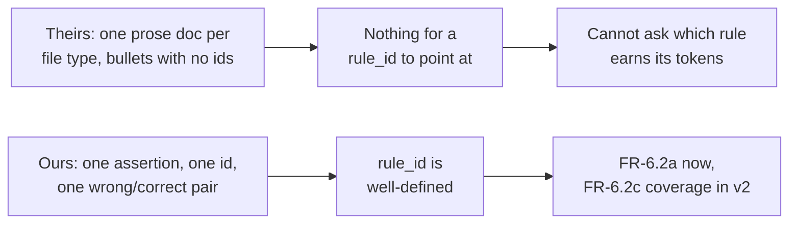

# Rule matching: our plan vs. alibaba/open-code-review

> **Non-normative.** A comparison of mechanisms, written 2026-11-06 against [`../agentic-code-review-srs-v1.md`](../agentic-code-review-srs-v1.md) §4.8 (CF-8) and the design in [`../design/02-domain-model.md`](../design/02-domain-model.md) §3.8 and [`../design/06-verification.md`](../design/06-verification.md) §1. It introduces no requirement. Where it suggests a change, that change needs an SRS amendment to become real.

## 0 · Provenance, and one broken link

| Source | Status |
|---|---|
| `https://github.com/alibaba/open-code-review` | Read: README, `.opencodereview/rule.json`, `internal/llm/providers.go`, `internal/tool/definitions.go`, `internal/model/review.go`, `internal/config/rules/system_rules.json`, `internal/config/rules/rule_docs/go.md`, several directory listings |
| `https://open-codereview.ai/docs/review-rules` | **HTTP 404.** Substituted with the in-repo source of that same page, `pages/src/content/docs/en/review-rules.md` |

Repo vitals as the README page reported them: Apache-2.0, Go, ~49.6k stars, 833 commits, distributed via npm (`@alibaba-group/open-code-review`, binary `ocr`), install scripts, release binaries, and a GitHub Action. Originated as Alibaba's internal reviewer. The latest-commit date was not captured. Field names and snippets below are as read from those files; nothing here was re-verified by running the tool.

---

## 1 · The two mechanisms side by side

| | **Our plan (CF-8)** | **open-code-review** |
|---|---|---|
| Rule format | `PatternRule`: `id`, `title`, `category`, `default_severity`, `wrong`, `correct`, `applies_when` | JSON object: `path` (glob), `rule` (free prose), `merge_system_rule` (bool) |
| Rule granularity | One checkable assertion, with a wrong/correct example pair | One prose checklist per **file type** (63 markdown docs; `go.md` is 69 lines of sections whose bullets carry no identifiers) |
| Where rules live | `core/patterns/` (package data) + user config | Four layers: `--rule <file>` > `<repo>/.opencodereview/rule.json` > `~/.opencodereview/rule.json` > embedded `system_rules.json` |
| Built-in count | **5** (FR-6.3a floor; breadth is v2, FR-6.3) | **63** rule docs, mapped from 64 globs |
| Who matches | **The LLM** (HLR-14 rejected; FR-5.3, FR-6.2a) | **The LLM** — rule text is interpolated as `{{system_rule}}` into the plan and main task prompts |
| Deterministic layer | **File filtering only.** The union of the rules' `applies_when` scopes decides which changed files are reviewed; the rule *text* is never selected, the whole library being static ([`02-domain-model.md`](../design/02-domain-model.md) §3.8) | Both: top-level `include`/`exclude` plus a six-gate filter decide which files are reviewed, and a per-rule `path` glob decides which rule text each file's prompt gets |
| Rule id in the finding | **Required** when a rule fired (FR-6.2a, AC-4) | **Absent.** `LlmComment` has no rule field |
| Findings enter via | Schema-validated `emit_finding` tool call (FR-5.6a) | `code_comment` tool producing `LlmComment` |
| Model turns | **One pass** over the change set (SRS §2.1; FR-5.7's ceiling bounds tool calls *within* it, and since v1.1 its default is positive). A grouped multi-call mode for large change sets is planned | Agentic multi-turn, per-file sub-agents, compression and retry |
| Executes the project's tests / type-check | **Yes** (FR-4.1, FR-4.7) — the differentiator | **No.** Registered tools are `file_read`, `file_find`, `file_read_diff`, `code_search`, `code_comment`, `task_done`, `unknown`. No shell |
| Measurement | In-repo corpus, runs as a test, catch rate + FP rate, settings pinned (FR-6.2b/d/e/f) | **AACR-Bench**, external (HuggingFace): 50 repos, 200 PRs, 10 languages, 1,505 annotated issues. No in-repo runner found |
| Languages | TS/JS only | ~60 file types, by extension |
| Parsing | tree-sitter, in-process (CF-2) | None found — diff text plus whole-file reads |

---

## 2 · Where we agree, and why that matters

**Two of our more contestable decisions turn out to be what a 49.6k-star production tool also does.** Convergent evidence, not proof, but it is the cheapest kind available:

1. **No rule-matching engine separate from the model.** The SRS rejects HLR-14 — "The LLM applies the rules and names them (FR-6.2a)." open-code-review does the same: its deterministic machinery decides *which rule text to show the model for which file*, and the model does all the judging. There is no regex or AST rule engine in it either. Our rejection of HLR-14 was recorded as a scoping choice; it is also the observed shape of the field.

2. **Findings enter through a tool call, never by parsing prose.** FR-5.6a and ADR-0004 are mirrored by their `code_comment` tool and the `LlmComment` struct it fills. Nobody is regexing model prose for findings.

A third, weaker agreement: **false positives are the live constraint, not recall.** Their `go.md` opens by telling the model to "Favor precision over recall: report only defects that are likely real" — the same worry as POV-4 and as FR-6.2f's clean cases. The difference is where it is handled: they handle it in the prompt, we handle it in the instrument. Theirs is cheaper; ours is falsifiable.

---

## 3 · Where we diverge — three that are load-bearing

### 3.1 Rule attribution, and why they cannot have it

The sharpest difference. Their finding struct, `internal/model/review.go`:

```go
Path            string `json:"path"`
Content         string `json:"content"`
SuggestionCode  string `json:"suggestion_code,omitempty"`
ExistingCode    string `json:"existing_code,omitempty"`
StartLine       int    `json:"start_line"`
EndLine         int    `json:"end_line"`
Thinking        string `json:"thinking,omitempty"`
Category        string `json:"category,omitempty"`
Severity        string `json:"severity,omitempty"`
```

`category` (bug, security, performance, maintainability, test, style, documentation, other) and `severity` (critical, high, medium, low) are the only classification. **No field names the rule that produced the comment.** FR-6.2a requires one; AC-4 tests for it.

This is not an oversight they could patch in an afternoon, and that is the useful part:



Because a "rule" on their side *is* a 69-line checklist keyed to `**/*.go`, a rule identifier would carry almost no information: "this came from the Go rules" is already implied by the file extension. Granularity decides attributability, which decides whether per-rule efficacy can ever be measured. Our structured `PatternRule` buys that, and costs authoring effort and prompt tokens — the trade R-6 already books.

### 3.2 Execution evidence: the market gap is real, and sharper than stated

The problem definition claims execution-backed review is "nearly absent from the market". This tool strengthens that claim rather than weakening it, and adds a wrinkle worth recording:

- No shell, bash or exec tool is registered. The reviewed project's tests, type-checker and linters **cannot** be run.
- `go.md` instructs the model *not to duplicate what `go vet`, Staticcheck, `go test -race`, the compiler and `gofmt` can determine.*

So the most-starred open-source AI reviewer handles the execution gap by **excluding** the territory those tools cover — telling the model to stay off ground it cannot verify. That is a defensible choice, and it is the opposite of our bet: FR-4.1 and FR-4.7 run those tools and attach the output as evidence (FR-5.2c, AC-2, AC-15). The comparison does not settle who is right. It does mean our differentiator is still unoccupied by the obvious incumbent, and that there is a *reason* for the vacancy — running a stranger's toolchain is the expensive, risky part, which FR-10.3d already fences off.

### 3.3 Measurement: they have far more corpus, we have the better instrument

Honest accounting, because this is where we are weakest in absolute terms:

| | Theirs (AACR-Bench) | Ours (FR-6.2b/d/f) |
|---|---|---|
| Scale | 200 real PRs, 1,505 annotated issues, 10 languages, cross-validated by 80+ senior engineers | 5 rules and a handful of fixture cases |
| Lives where | External HuggingFace dataset; **no in-repo runner found** | `tests/corpus/`, runs as an ordinary test (AC-5) |
| Match predicate | Not published in what was read | Documented and line-independent: file + enclosing symbol + category + rule when both carry one ([`06-verification.md`](../design/06-verification.md) §1.2) |
| Clean cases / precision | Precision appears in the README's comparison; construction not inspectable from the repo | `is_clean` cases required; FP rate reported beside catch rate (FR-6.2f) |
| Settings pinned | Not found | Depth, ceiling, model, temperature 0, seed, `--repeat 3`, median and spread (FR-6.2e) |
| Per-rule breakdown | Impossible — see §3.1 | FR-6.2a now, FR-6.2c in v2 |

Their corpus is an order of magnitude beyond anything v1 will build, and it is credible in a way ours is not yet — 80+ engineers against our N=1 taxonomy, which the problem definition already flags. What it does not do is make *their own rule set* measurable: a benchmark that lives outside the repo, with no runner in it, cannot gate a change to a rule doc. Ours can, from delivery step 3 onward. That is the POV-2 instrument argument restated against a real example — and the first place to look if we ever want external validity rather than only internal comparability.

---

## 4 · What is worth borrowing

| # | From them | Why | Cost to us |
|---|---|---|---|
| 1 | **Layered rule precedence** — CLI override > project > user-global > built-in, first match wins | We have a rule library and a config file but no stated precedence. Theirs is four lines of documentation and removes a whole class of "which rule won?" confusion | Config-shaped; CF-9 plus `core/patterns/` |
| 2 | **The glob as scope** ✅ **adopted 2026-11-06, for files rather than for rule text** | `applies_when` was one undesigned field, and a path glob is its obvious concrete form. Their glob does two jobs; ours does one of them and goes further on it. **Declined:** choosing per file which rule text the model sees — our library is static and ships whole in a cacheable prefix. **Adopted, and then some:** scope filters *files*, with the union of rule scopes deciding what is reviewed at all, where theirs sources file filtering from top-level `include`/`exclude` instead. Their case-insensitivity is declined, for the dialect FR-3.5 already uses | The file-filtering half **owes an SRS amendment** — FR-3.5 authorises one exclusion source, and this is a second ([`02-domain-model.md`](../design/02-domain-model.md) §3.8) |
| 3 | **`merge_system_rule` as a composition primitive** | A user rule that *appends to* rather than *replaces* a built-in one is a genuinely useful third option we have not considered | Design only |
| 4 | **"Favor precision over recall" stated inside the rule text** | Cheap prompt-level FP discipline that does not wait for the corpus. Ours relies entirely on measurement, which only helps after step 3 | One line of prompt, measurable against the baseline afterwards |
| 5 | **Their public benchmark as an external yardstick** | AACR-Bench's TS/JS slice is a ready-made external check on a catch rate that is otherwise only internally comparable — a better answer to "is 62% any good?" than TBD-6 has today | Real work: a corpus adapter, and their cases are PR-shaped, not fixture-shaped. Not v1 |

**What not to borrow:** prose-checklist rules keyed to file type. It is cheaper to author, and it is why they have 63 "rules" to our 5 — and it forecloses FR-6.2a, FR-6.2c, and any per-rule experiment. The scale gap is real, but it is a gap in *authoring*, not in mechanism; closing it their way would cost us the instrument the whole Commit-First decision rests on.

---

## 5 · What this sharpens for us

1. **R-6 is understated.** "Five rules is not a product" reads as a known limitation; against 63 built-in docs it is a 12× breadth gap on the axis a user notices first. The answer is still not to abandon structure (§4), but rule authoring deserves to be planned work with a target, not a floor we satisfy and move past.
2. **The single pass is the minority position.** The property is SRS §2.1's ("the model is called once"), not FR-5.7's — FR-5.7 bounds tool calls *within* a call. Their loop is multi-turn with read tools, per-file sub-agents, compression and retry. A grouped multi-call mode is planned here for large change sets, and when it lands it owes an amendment to that §2.1 sentence, a per-bundle answer for the ceiling and FR-8.2d's totals, a corpus unit under FR-6.2d, and a partial-run degradation under FR-11.2. FR-5.7b's single-pass baseline is what it will be measured against.
3. **Their per-file rule selection is a token optimisation we answer differently.** Selecting rule text per file is how they reach ~1/9 the tokens — but it makes the prompt prefix vary with every change set. Our rules never vary, so the whole library goes in a static system prompt instead, trading a larger prefix for a cacheable one ([`02-domain-model.md`](../design/02-domain-model.md) §3.8). Whether our default provider caches that prefix is unverified, and worth confirming before the trade is called a win.
4. **`applies_when` was the last undesigned field in `PatternRule`** — decided 2026-11-06 off the back of this comparison. Two further borrowables remain open, both config-shaped: layered rule precedence (§4, item 1) and `merge_system_rule` (§4, item 3).
4. **The problem definition's market claim survives contact** — with a better reason attached (§3.2), worth folding into the next revision of [`004-market-study.md`](./enterpenuership/004-market-study.md) rather than leaving as "nearly absent".

## 6 · Unverified

Their `--format json` wrapper around `LlmComment`; the last-commit date; whether `file_find` and `code_search` shell out internally (they are not exposed as command execution either way); the AACR-Bench methodology beyond the README's claims, and its reported precision/F1/recall numbers, which sit in an image that was not read; and whether a rule doc's bullets carry identifiers in any file other than `go.md`.
