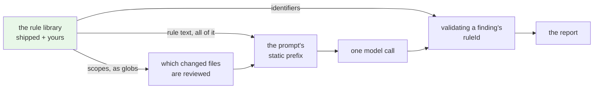
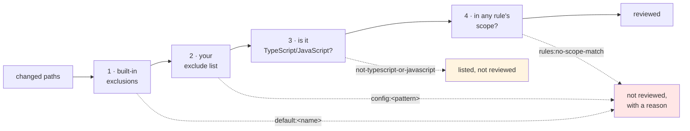

# Writing Review Rules

How the rule library works, and everything needed to write rules of your own.

**Written against:** feature 003, phases 1–5. This guide describes what the code **does today**, not what the
specification promises. What is deliberately not supported is [section 9](#9-what-is-not-supported-yet).

**Authority:** this is an operating guide, not a normative document. Behaviour is defined by
[`agentic-code-review-srs-v1.md`](./agentic-code-review-srs-v1.md) (FR-6.1, FR-6.1a, FR-6.2a, FR-6.3a); the rule
document's format and its failure messages by
[`specs/003-rule-library/contracts/rules-file.md`](../specs/003-rule-library/contracts/rules-file.md), and review
scope by [`contracts/rule-scope.md`](../specs/003-rule-library/contracts/rule-scope.md). Where this guide
disagrees with them, this guide is wrong.

---

## Contents

1. [What a rule is, and what the reviewer does with it](#1-what-a-rule-is-and-what-the-reviewer-does-with-it)
2. [Where rules come from, and why there is no precedence](#2-where-rules-come-from-and-why-there-is-no-precedence)
3. [The rule document](#3-the-rule-document)
4. [Path matching](#4-path-matching)
5. [Inclusion and exclusion](#5-inclusion-and-exclusion)
6. [Scope decides what gets reviewed](#6-scope-decides-what-gets-reviewed)
7. [When nothing is in scope](#7-when-nothing-is-in-scope)
8. [Attribution: a finding that names its rule](#8-attribution-a-finding-that-names-its-rule)
9. [What is not supported yet](#9-what-is-not-supported-yet)
10. [Failures, and what each message means](#10-failures-and-what-each-message-means)
11. [A worked example](#11-a-worked-example)

---

## 1. What a rule is, and what the reviewer does with it

A rule is a named **"wrong versus correct" pair** with a category, a default severity, and a declaration of which
paths it applies to. It is guidance given to the model, not a matcher run against your code.

That last point decides almost everything else in this guide. There is **no rule-matching engine**: nothing in the
tool scans your source for a rule's pattern. The deterministic part of a rule is its *path scope*, and the only
thing the tool does with it is decide which changed files are worth reviewing at all. The rule's text — its title
and its two examples — goes to the model, every review, unconditionally.



Loaded once per run, validated once, then read three times: as globs by the change-set resolver, as text by the
prompt, and as identifiers when a finding is validated.

**Three consequences worth knowing before you write a rule.**

| | |
|---|---|
| Every rule is always visible to the model | There is no per-run selection of a subset. A rule cannot be missed because it was not offered. |
| A rule firing is a judgement, not a match | The model decides whether a rule applies to the code in front of it. A rule whose examples are vague will be applied vaguely. |
| Scope is the one deterministic thing you control | A file no rule's scope covers is never sent to the model, and the run says so. |

---

## 2. Where rules come from, and why there is no precedence

Two sources, in this order:

| Order | Source | Required |
|---|---|---|
| 1 | The **shipped library** — five rules, package data inside the installed tool | Always present |
| 2 | **One file you configure**, through `patterns.rules` | Optional |

```yaml
# .agentic-review.yml, at the root of the repository being reviewed
patterns:
  rules: ./review-rules.yml     # optional; absent means the shipped library alone
```

| Key | Type | Default | Notes |
|---|---|---|---|
| `patterns.rules` | path | *(unset)* | Relative to the repository root, or absolute. Unset is not an error and is not reported as missing anything |

Unknown keys under `patterns` are errors, as everywhere else in the configuration.

### There is no precedence order, by design

**Your rules are added to the shipped ones. They never replace them, and neither wins over the other.** There is
no precedence order to learn, because there is nothing to resolve: an identifier belongs to exactly one rule, and
a collision is an **error** rather than a winner.

```
review-rules.yml: rules[2].id: 'unawaited-promise-in-try' is already defined by a built-in rule
```

This follows the merge semantics the configured `exclude` list already uses — added to the defaults, never
substituted for them. It is also why you cannot currently switch a shipped rule off or narrow its scope; see
[section 9](#9-what-is-not-supported-yet).

### The precedence that does exist

Four mechanisms can keep a changed file out of a review, and they are consulted in a fixed order. The **first one
that applies owns the file**, and its reason is the one reported — which is the point, because a reviewer who
cannot tell *"no rule covered this"* from *"the tool looked and found nothing"* has been told nothing.



| Order | Mechanism | Reason reported | Where |
|---|---|---|---|
| 1 | Built-in exclusions (`node_modules/**`, `dist/**`, lockfiles, …) | `default:<name>` | `changeSummary.excluded` |
| 2 | Your `exclude` patterns | `config:<pattern>` | `changeSummary.excluded` |
| 3 | Not a reviewed language, deleted, or binary | `not-typescript-or-javascript`, `deleted`, `binary` | `changeSummary.files`, with `reviewed: false` |
| 4 | **No rule's scope covers it** | `rules:no-scope-match` | `changeSummary.excluded` |

Two things follow from the order. A changed `README.md` is reported as *not a reviewed language* and **never** as
*no rule applies* — the honest reason wins. And a file one of your `exclude` patterns already removed never
reaches the scope question at all, so you will not see two explanations for one path.

Within mechanism 1, a built-in exclusion is checked before your `exclude` list, so when both match a path the
built-in rule is the one named.

---

## 3. The rule document

A rules file is a YAML mapping with one key, `rules`, holding a list of rule mappings.

```yaml
rules:
  - id: no-unawaited-promise
    title: A promise created inside try is not awaited, so its rejection escapes the catch
    category: error-handling
    defaultSeverity: blocking
    appliesWhen:
      include: ["src/**/*.ts", "src/**/*.tsx"]
      exclude: ["**/*.test.ts"]
    wrong: |
      try {
        void save(record);          // rejection escapes this try
      } catch (error) {
        report(error);
      }
    correct: |
      try {
        await save(record);
      } catch (error) {
        report(error);
      }
```

| Field | Required | Shape |
|---|---|---|
| `id` | yes | A stable slug: lowercase letters and digits joined by **single** hyphens. Unique across the whole loaded library |
| `title` | yes | One non-empty line. Shown to the model and in the terminal |
| `category` | yes | One of the finding model's categories (below) |
| `defaultSeverity` | yes | One of the finding model's severities (below) |
| `wrong` | yes | Non-empty. The violating example |
| `correct` | yes | Non-empty. The compliant counterpart |
| `appliesWhen` | no | `include` and `exclude` lists of path patterns. Omitted means **every file** |

Field names are `camelCase` in the file, as in every other serialised surface of this tool. **Unknown keys are
errors**, so a misspelt `appliesWen` fails loudly rather than silently leaving the rule universal.

### The vocabularies

A rule may not invent a category or a severity. Both come from the finding model, so that a rule's category and a
finding's category are always the same word:

| | |
|---|---|
| `category` | `correctness`, `error-handling`, `interface-contract`, `test-evidence`, `security`, `performance`, `maintainability` |
| `defaultSeverity` | `blocking`, `important`, `nit` |

**`defaultSeverity` is a default, not a verdict.** A finding's severity stays the model's to choose within that
same vocabulary. The rule's value is what applies when nothing else says otherwise; nothing in the tool today
overrides a model-set severity with it.

### Writing the two examples

Both are sent verbatim, inside a fenced block, as part of every prompt. They are the rule's entire explanation of
itself, so:

- Make them **minimal and contrasting** — ideally the same code twice, differing only in the thing the rule is
  about. The reviewer learns the rule from the difference.
- Keep them **short**. The whole library sits in every prompt, so a long example is paid for on every review.
- A comment in `wrong` pointing at the problem is useful; the shipped rules do this.
- `wrong` and `correct` must differ. Identical examples teach nothing, and a test rejects them in the shipped set.

### Identifiers

The `id` is what a finding cites, so treat it as a stable name rather than a description:

| Valid | Invalid | Why |
|---|---|---|
| `no-unawaited-promise` | `No Unawaited` | Uppercase and spaces |
| `widened-return-type` | `no_unawaited_promise` | Underscores |
| `sql-injection-2` | `no--unawaited` | Double hyphen |
| | `-leading`, `trailing-` | Leading or trailing hyphen |

Renaming an `id` is not a cosmetic change: reports written before the rename cite the old name.

---

## 4. Path matching

Patterns are **repository-relative**, **POSIX-separated** (forward slashes, on Windows too), **case-sensitive**,
and must match the **whole** path. This is the same dialect as the configuration's `exclude` list — one dialect in
the tool, not two.

| Syntax | Meaning |
|---|---|
| `**` | zero or more whole path segments |
| `*` | any characters, within one segment |
| `?` | exactly one character, within one segment |
| no `/` anywhere in the pattern | matches at **any** depth |

Every row below is verified against the matcher:

| Pattern | Path | Matches |
|---|---|---|
| `**/*.ts` | `src/a.ts` | ✅ |
| `**/*.ts` | `a.ts` | ✅ |
| `**/*.ts` | `src/deep/a.ts` | ✅ |
| `**/*.ts` | `src/a.tsx` | ❌ — `.tsx` is not `.ts` |
| `**/*.ts` | `src/A.TS` | ❌ — **case-sensitive** |
| `src/**` | `src/a.ts` | ✅ |
| `src/**` | `src/deep/a.ts` | ✅ |
| `src/**` | `other/src/a.ts` | ❌ — anchored at the repository root |
| `src/**/*.ts` | `src/a.ts` | ✅ — `**` matches **zero** segments too |
| `src/**/*.ts` | `src/deep/a.ts` | ✅ |
| `src/*.ts` | `src/a.ts` | ✅ |
| `src/*.ts` | `src/deep/a.ts` | ❌ — `*` stays inside one segment |
| `src/?.ts` | `src/a.ts` | ✅ |
| `src/?.ts` | `src/ab.ts` | ❌ — one character |
| `*.config.ts` | `vite.config.ts` | ✅ |
| `*.config.ts` | `packages/a/vite.config.ts` | ✅ — no `/`, so any depth |
| `src/api/handler.ts` | `src/api/handler.ts` | ✅ — an exact path is a valid pattern |
| `**/__tests__/**` | `src/__tests__/a.ts` | ✅ |

### Two traps

**`src/**` and `src/**/*.ts` are not the same.** The first covers every file under `src/`, including
`src/data.json`; the second covers only `.ts` files. Since non-TypeScript files are already out of review by
mechanism 3, the difference rarely matters for scope — but it matters if you are reading a rule to understand what
it claims to cover.

**A pattern with no `/` floats.** `*.config.ts` matches at any depth, which is usually what you want for a
filename pattern and almost never what you want for a directory.

### Patterns are not checked for validity

There is no such thing as an invalid pattern beyond its shape. The translator accepts any string and produces a
matcher, so a typo gives you a rule that **matches nothing** rather than an error. These *are* rejected, because
they are shape errors rather than typos:

| Rejected | Why |
|---|---|
| `/src/**` | Leading `/`. Patterns are repository-relative |
| `src\**` | Backslash. POSIX separators only |
| `""` | Empty |
| `include: []` | An empty include list — a rule that can never apply is certainly a mistake |

So after writing a scope, **check it rather than trusting it**. [Section 11](#11-a-worked-example) shows how.

---

## 5. Inclusion and exclusion

```
a file is in the scope of rule R   ⟺   any(R.include matches it)  and  not any(R.exclude matches it)
a file is in the review scope      ⟺   any(it is in the scope of R)  for R in the library
```

Three properties, and the first is the one that surprises people:

### Exclusions are per rule, never pooled

**One rule's `exclude` narrows that rule and nothing else.** A file that rule A excludes and rule B includes **is
reviewed**.

This matters immediately, because the shipped library is built that way. Four of the five shipped rules are
production-code rules that exclude `**/*.test.ts`; the fifth is written *for* test files and includes it. Under the
pooled reading — gather every `include`, gather every `exclude`, then subtract — every test file in your repository
would silently drop out of review, including the files the fifth rule exists to examine.

```yaml
# rule A: production code
appliesWhen:
  include: ["src/**/*.ts"]
  exclude: ["**/*.test.ts"]

# rule B: tests
appliesWhen:
  include: ["src/**/*.test.ts"]
```

`src/thing.test.ts` is **in scope**: rule A excludes it, rule B includes it, and rule B's inclusion is not rule A's
business.

### A rule with no `appliesWhen` covers everything

The default is `include: ["**/*"]` with an empty `exclude` — every file, at every depth. It is the harmless
default: a rule written without thinking about scope does not narrow anybody's review.

### An empty library excludes nothing

If no rule is loaded at all, every file stays in scope. With no rule to fail to match, nothing is excluded on this
ground — which stops a configuration mistake from producing a correct-but-useless empty review.

### A rule that excludes what it includes covers nothing

`include: ["**/*.ts"]` with `exclude: ["**/*.ts"]` is accepted and applies to nothing. It is not an error, because
each list is individually sensible; it is simply a rule that never fires.

---

## 6. Scope decides what gets reviewed

The union of the library's scopes **is** the review scope. A changed file no loaded rule applies to is not sent to
the model, and the run records it.

The filter runs when the change set is resolved — before anything is parsed, executed against or budgeted for —
and only on files that would otherwise have been reviewed.

In the terminal:

```
Excluded (1):
  src/ui/widget.ts (rules:no-scope-match)
  of which 1 file no loaded review rule applies to.
```

In the JSON report, under `changeSummary.excluded`:

```json
{ "path": "src/ui/widget.ts", "rule": "rules:no-scope-match" }
```

The reason takes the same `<source>:<detail>` shape as the other two, so a consumer can split on `:` and branch on
the source. Admitting it moved the report schema from `1.0` to `1.1`.

**A rule-scope exclusion is not a degradation.** Nothing failed — a configured exclusion is not a failure either,
and this is the same kind of thing. A run whose only exclusions are of this kind reports an empty `degradations`
list, and that is asserted by a test rather than left to chance.

### This cuts both ways

Narrow scopes make the reviewer cheaper and more focused. They also mean **a file nobody wrote a rule for is not
reviewed at all** — which is a defensible policy and a surprising one if you did not choose it deliberately. Two
rules of thumb:

- Keep the **union** wide enough to cover an ordinary source file in your repository. If `src/thing.ts` matches no
  rule, your reviewer is reviewing less than you think.
- Make sure **at least one rule covers test files**, unless you genuinely do not want tests reviewed. Otherwise a
  test-only change is set aside entirely, while the reviewer's instructions explicitly ask it to look for
  behaviour changed without a test and for tests that were weakened.

The shipped library satisfies both, and tests enforce that it keeps doing so.

---

## 7. When nothing is in scope

If review scope leaves no file, the run **completes**. It does not fail, and it is never reported as a clean
review:

| | |
|---|---|
| The model | **Not called.** Zero provider requests, zero tokens |
| Verdict | **`nothing-to-review`** — its own verdict, distinct from `no-findings` |
| Exit code | **0.** Nothing failed, so this is not the *no judgement* case (exit 2) |
| The report | Still written, naming every set-aside file and its reason |
| Stage timings | No `assembly` and no `review` entry: the skip is visible, not a silent no-op |

**Read the verdict, not the exit code**, if you are scripting against this: exit 0 is shared with a clean review,
and the verdict is what tells the two apart.

```bash
jq -r '.verdict' review.json     # nothing-to-review | no-findings | findings | blocking | no-judgement
```

---

## 8. Attribution: a finding that names its rule

When a finding comes from a rule, it carries that rule's identifier:

```
src/search.ts:4  blocking  security
  Concatenating the 'name' parameter directly into the SQL query enables SQL injection.
  evidence: diff hunk 0
  rule: untrusted-input-in-query
```

```json
{ "file": "src/search.ts", "severity": "blocking", "ruleId": "untrusted-input-in-query" }
```

The identifier appears in the terminal, the JSON report and the HTML report. A finding that is the model's own
observation rather than a rule's carries no `ruleId` at all — the key is simply absent from the JSON — and that is
normal: most findings have no rule behind them.

**An identifier the run never showed the model is rejected.** Validation happens at the tool-call boundary against
the identifiers the library actually published, so an invented rule name cannot reach a report. It is rejected the
same way a malformed call is, which buys the model one chance to correct itself.

So a `ruleId` in a report means something precise: *this finding was attributed to a rule that was demonstrably in
front of the model on this run*. It does not mean the tool verified the rule was violated — that is still the
model's judgement.

---

## 9. What is not supported yet

| Not supported | What to do instead | Arrives in |
|---|---|---|
| **Overriding a shipped rule**, or narrowing its scope | Nothing, today. A colliding identifier is an error | v2 |
| **Switching a shipped rule off** | Nothing, today | v2 |
| A precedence order between your rules and the shipped ones | There is none to need: rules are added, and collisions are errors | — |
| **More than one** configured rules file | Put your rules in one file | v2 |
| Conditions other than paths — "the file imports `fs`", a content regex, a condition language | `appliesWhen` holds path globs only | not planned for v1 |
| Reporting **which rules fired**, as coverage, in the report | Read `ruleId` on each finding | v2 |
| A broad default rule set beyond the shipped five | Write your own | v2 |
| Any **measurement** of whether your rules improve review | Nothing, today. Catch rate and the false-positive figure arrive with the regression harness | feature 007 |

That last row is worth stating plainly: the tool currently gives you no way to tell whether a rule you added made
reviews better. Feature 007 builds the instrument that answers it.

---

## 10. Failures, and what each message means

Every failure below stops the run at **preflight**, with **exit 3**, **no provider call** and **no check
execution** — the same shape a malformed configuration already has. A bad rules file costs nothing.

| Cause | Message |
|---|---|
| The file does not exist | `patterns.rules: './review-rules.yml' does not exist` |
| Not valid YAML | `review-rules.yml: not valid YAML: <parser message>` |
| Top level is not a mapping with `rules` | `review-rules.yml: expected a mapping with a 'rules' list` |
| A rule is not a mapping | `review-rules.yml: rules[2]: expected a mapping` |
| A required field is missing | `review-rules.yml: rules[2].title: required` |
| An unknown key | `review-rules.yml: rules[2].appliesWen: unknown field` |
| A bad identifier | `review-rules.yml: rules[2].id: 'No Unawaited': expected a slug like 'no-unawaited-promise'` |
| A category outside the vocabulary | `review-rules.yml: rules[2].category: 'perf' is not a category` |
| An empty include list | `review-rules.yml: rules[2].appliesWhen.include: must name at least one pattern` |
| An absolute or Windows-separated pattern | `review-rules.yml: rules[2].appliesWhen.include[0]: '/src/**': expected a repo-relative POSIX pattern` |
| Two rules share an identifier | `review-rules.yml: rules[2].id: 'no-unawaited-promise' is already defined by a built-in rule` |

The index in `rules[2]` is the rule's position in the file, counting from zero. The offending rule's identifier is
named where one exists; the index is given where the identifier itself is the problem.

One case that is **not** an error, and catches people out:

| Looks wrong | Actually |
|---|---|
| A pattern that matches nothing | Accepted. The rule simply never applies — see [section 4](#4-path-matching) |
| `patterns.rules` unset | Accepted. The shipped library alone, and nothing is reported as missing |
| A configured file whose `rules` list is empty | Accepted. It contributes no rules |

### One more, specific to pull requests

A `--pr` review has no local repository, so there is no repository root for a relative path to resolve against:

```
patterns.rules: './review-rules.yml' is relative, and a --pr review has no repository root to resolve it against.
Give an absolute path, or drop the key.
```

Use an absolute path in the file you pass with `--config`. This is loud rather than silent on purpose: resolving
against the current directory would read a rules file from wherever the tool happened to be run.

---

## 11. A worked example

Say you want one rule of your own: no `any` in an exported signature, in your API layer only.

**1 · Write the file**, at the repository root:

```yaml
# review-rules.yml
rules:
  - id: no-any-in-exported-signature
    title: An exported function takes or returns any, so every caller loses type checking
    category: interface-contract
    defaultSeverity: important
    appliesWhen:
      include: ["src/api/**/*.ts"]
      exclude: ["**/*.test.ts"]
    wrong: |
      export function parse(payload: any): any {
        return JSON.parse(payload);
      }
    correct: |
      export function parse(payload: string): Record<string, unknown> {
        return JSON.parse(payload) as Record<string, unknown>;
      }
```

**2 · Point the configuration at it:**

```yaml
# .agentic-review.yml
patterns:
  rules: ./review-rules.yml
```

**3 · Check that it loads, and that its scope is what you meant.** This runs offline and costs nothing:

```bash
uv run python -c "from agentic_review.core.patterns import load_library; from pathlib import Path; lib = load_library(Path('review-rules.yml')); print(lib.source, len(lib.rules)); [print(' ', r.id, r.applies_when.include) for r in lib.rules]"
```

Expect `shipped + review-rules.yml`, six rules, and your rule's include list exactly as you wrote it. A typo in a
field fails here, with the file and the field named.

**4 · Check which files the whole library covers**, since your rule is added to the shipped five rather than
replacing them:

```bash
uv run python -c "from agentic_review.core.patterns import load_library; from agentic_review.core.changeset.exclusion import in_any_rule_scope; from pathlib import Path; lib = load_library(Path('review-rules.yml')); [print(f'{p:34} {in_any_rule_scope(p, lib.scope_globs)}') for p in ['src/api/users.ts', 'src/ui/widget.ts', 'scripts/build.ts', 'src/api/users.test.ts']]"
```

This is the step worth not skipping. It answers the question a scope is actually for — *will this file be
reviewed?* — without a model call, and it is where you find out that `scripts/build.ts` is covered by nothing.

**5 · Run the review.** Your rule is in the prompt beside the shipped five, in identifier order, and the model is
asked to cite it when a finding comes from it.

### What the model is shown

For reference, each rule renders like this, in the system message, every review:

````text
## Review rules

### no-any-in-exported-signature
An exported function takes or returns any, so every caller loses type checking
Category: interface-contract · default severity: important
Applies to: src/api/**/*.ts — except **/*.test.ts

Wrong:
```ts
export function parse(payload: any): any {
  return JSON.parse(payload);
}
```
Correct:
```ts
export function parse(payload: string): Record<string, unknown> {
  return JSON.parse(payload) as Record<string, unknown>;
}
```
````

Three properties of that rendering are contractual: each identifier appears **verbatim**, each rule's declared
scope appears **with** it, and the block is **byte-identical** for a given library across different change sets.
Everything else about the wording may change between versions — it is not a format to parse.

---

## See also

| | |
|---|---|
| [`operation_guidelines.md`](./operation_guidelines.md) | Installing, configuring and running the tool; the full `.agentic-review.yml` reference and the exclusion patterns |
| [`specs/003-rule-library/contracts/rules-file.md`](../specs/003-rule-library/contracts/rules-file.md) | The rule document's contract, and every failure message |
| [`specs/003-rule-library/contracts/rule-scope.md`](../specs/003-rule-library/contracts/rule-scope.md) | Review scope's contract: the predicate's properties and the report's new reason |
| [`design/02-domain-model.md`](./design/02-domain-model.md) | Why the library is static, and why scope is review scope |
