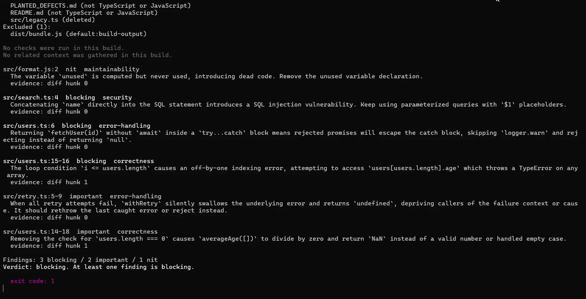
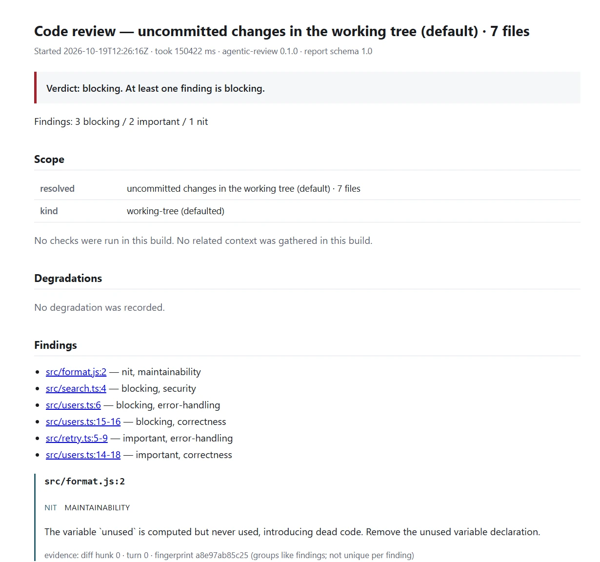
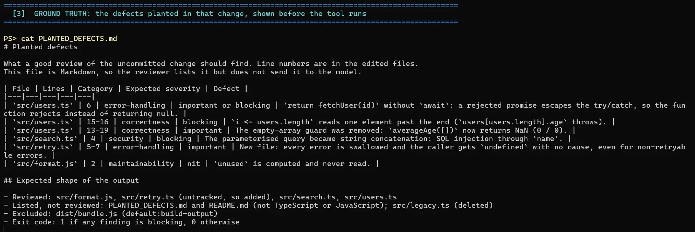

# agentic-review

A local command-line reviewer for TypeScript and JavaScript changes. It resolves a change set, passes it to a single model pass, and reports schema-validated findings in the terminal, as JSON and as a self-contained HTML page. A finding can enter the system only through a validated `emit_finding` tool call, and every degraded run says what it could not do.



*One run over a change with six deliberately planted defects. Every finding names a file and line, a severity, a category and the diff hunk it rests on; the run ends `blocking`, so the exit code is 1.*

**Status:** the walking skeleton (feature 001) is built: the `review` and `render` commands, the working-tree, branch-range and public pull-request scopes, and the terminal, JSON and HTML outputs. Running the reviewed project's tests and type check, gathering related context, the pattern library and the `regression` command are not built yet. [`Docs/operation_guidelines.md`](./Docs/operation_guidelines.md) §11 lists everything that is missing.

## Install

Requires git, [uv](https://docs.astral.sh/uv/) and CPython 3.12 or 3.13.

```
uv sync
```

## Run

The tool needs a key for whichever OpenAI-compatible endpoint it is pointed at — by default Google's Gemini endpoint — in `AGENTIC_REVIEW_API_KEY` or in the user-level credentials file. Never put the key in the repository.

```
cp .env.example .env          # then set AGENTIC_REVIEW_API_KEY
uv run --env-file .env agentic-review review                                  # uncommitted changes
uv run --env-file .env agentic-review review --scope range --base main        # what this branch changed
uv run --env-file .env agentic-review review --pr https://github.com/OWNER/REPO/pull/N
uv run --env-file .env agentic-review review --json report.json --html report.html
uv run agentic-review render report.json --html report.html                   # re-render a saved report
```


Exit codes: `0` the review completed, `1` it found a `blocking` finding, `2` no review could be produced, `3` the run could not start. The full guide to configuration, results and troubleshooting is [`Docs/operation_guidelines.md`](./Docs/operation_guidelines.md).

## The same review as a page

`--html` writes one self-contained file — no assets, no network — rendered from the same JSON report, which stays authoritative. It carries the verdict, the scope that was resolved, every degradation, the findings in severity order, what was reviewed and what was only listed, and the run's own metadata: model, provider, token counts, tool calls, repair turns and per-stage durations.



*The head of the page. [The whole report in one image](./Docs/assets/screenshots/html-report-full.webp) — findings, change summary, excluded paths and run metadata.*

## The change in those screenshots

A small demo repository with defects planted on purpose, reviewed as uncommitted work:


The defects were written down before the tool ran, so the output could be checked against them rather than admired:



The run found all six, at the severities expected, and classified the rest of the change set as predicted: `src/retry.ts` reviewed although untracked, the two Markdown files and the deleted `src/legacy.ts` listed but not reviewed, `dist/bundle.js` excluded as build output. This is one run on one change set, not a measured catch rate — measuring that is what the unbuilt `regression` command is for.

## Configure the model and the endpoint

Two settings decide which model reviews the change and where the request — and the key — is sent: the model name and the base URL of any OpenAI-compatible endpoint. Both can come from the environment, next to the key in `.env`:

```
AGENTIC_REVIEW_API_KEY=...
AGENTIC_REVIEW_MODEL=gemini-3.5-flash-lite
AGENTIC_REVIEW_BASE_URL=https://generativelanguage.googleapis.com/v1beta/openai/
```

or from `.agentic-review.yml` at the root of the repository being reviewed, where they are the project's choice rather than one developer's:

```yaml
agent:
  model: "gemini-3.5-flash-lite"
  baseUrl: "https://generativelanguage.googleapis.com/v1beta/openai/"
```

| | |
|---|---|
| Resolution, per field | built-in defaults → `.agentic-review.yml` → environment → CLI flags |
| An unset or blank variable | overrides nothing: `AGENTIC_REVIEW_MODEL=` reads as absent |
| An invalid value | stops the run before anything is sent, exit 3, naming the variable |
| What was actually used | `run.model` and `run.provider` in every report |

The built-in defaults live in [`settings.py`](./src/agentic_review/core/config/settings.py) as `DEFAULT_MODEL` and `DEFAULT_BASE_URL`, and are placeholders until test S-1 chooses a model. The endpoint must serve a model that **calls tools**: one that never calls `emit_finding` produces a `no-tool-call` degradation on every run. [`Docs/operation_guidelines.md`](./Docs/operation_guidelines.md) §5 covers choosing a model, listing what an endpoint serves, and what a retired model looks like.

## Develop

```
uv run pytest           # the offline test suite
uv run lint-imports     # the structural import contracts
```

## Documentation

- [`Docs/agentic-code-review-srs-v1.md`](./Docs/agentic-code-review-srs-v1.md) is the specification being built, and is normative.
- [`Docs/technical_stack.md`](./Docs/technical_stack.md) says what it is built with.
- [`Docs/README.md`](./Docs/README.md) indexes everything else.

## Licence

No licence has been chosen yet. Until a `LICENSE` file is added, no rights to use, copy or modify this code are granted.
