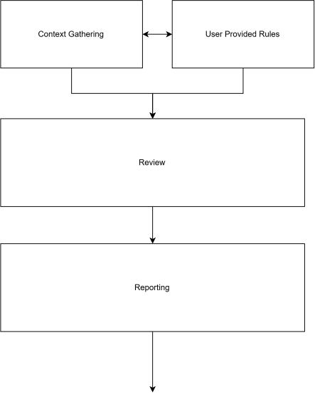
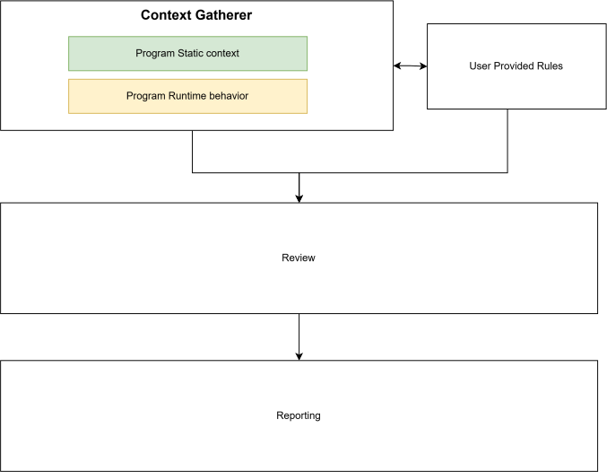
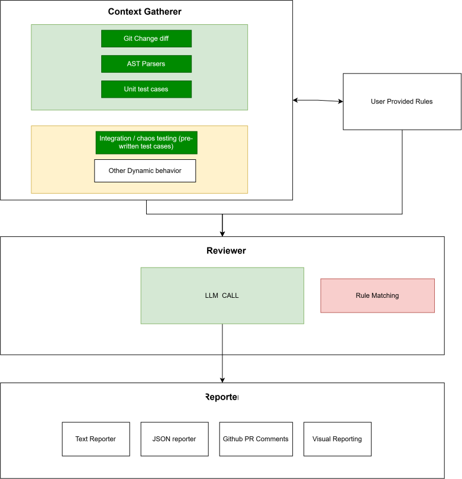

The architecture is drawn in three diagrams. Each level keeps everything in the one above it and adds detail inside its boxes, so read them in order. They describe the whole product, not only v1. Each section ends with what that part of the drawing means in the code today.

The [component design](../../../Docs/design/Component-design/README.md) page lists the requirements (HLR-1 to HLR-23) read off these diagrams and how each maps to the v1 SRS.

## Level 1: four blocks, one direction



The system reviews a code change in four blocks:

- **Context Gathering** collects what is needed to judge the change.
- **User Provided Rules** are the reviewing team's own standards, supplied from outside the system.
- **Review** judges the change using both of them.
- **Reporting** turns the review's result into output.

The edges are the important part of this level:

| From | To | Meaning |
|---|---|---|
| Context Gathering | User Provided Rules | Both directions. The only two-way edge in any of the diagrams |
| Context Gathering | Review | Gathered context feeds the review |
| User Provided Rules | Review | Rules feed the review directly, not only through context gathering |
| Review | Reporting | The review's result is reported |

Everything flows forward: gather, then review, then report. **Review has no edge back to Context Gathering**, so the reviewer works with the context it is given and never asks for more (HLR-15, HLR-22). Two things are deliberately not drawn: where the change comes from (no edge feeds Context Gathering), and who reads the output. The arrow leaving Reporting at the bottom has been removed from the design.

**In the code.** The forward order is a fixed pipeline owned by our code, not by the model (ADR-0001). It is declared as an acyclic LangGraph graph in `agents/pipeline_agent.py`:

```
preflight → resolve_change_set → parse_and_context → execute_checks
  → load_patterns → assemble_context → review → build_report
```

## Level 2: two kinds of context



Level 2 opens one box. Context Gathering becomes the **Context Gatherer**, with two kinds of context inside it. The other three blocks and every edge from level 1 are unchanged.

- **Program static context** (green) comes from the program text, without running it.
- **Program runtime behavior** (yellow) comes from running the program.

The split matters because the two are obtained differently. Static context is read from the repository. Runtime evidence means executing the reviewed project's own toolchain, which can fail, time out or be missing. The system must still produce a review in that case, and report what it couldn't do (FR-11.2).

**In the code.** General observation of a running program is out of scope (HLR-6). v1 gets runtime evidence only from the project's own checks: its tests and its type-check (FR-4.1, FR-4.2). They run once, before the review, and the model can't trigger them (FR-4.6).

## Level 3: the parts inside each block



Level 3 names what sits inside each block. A **dark green** fill marks a decided component, one whose design is settled.

### Inside the Context Gatherer

| Component | Kind | Status | In v1 |
|---|---|---|---|
| Git change diff | Static | Decided | CF-1 resolves the change set from the working tree, a branch range or a public pull request. **Built** |
| AST parsers | Static | Decided | CF-2 parses the changed files and gathers related context. Not built yet (feature 004) |
| Unit test cases | Static | Decided | CF-3 runs them. Not built yet (feature 002) |
| Integration / chaos testing (pre-written test cases) | Runtime | Decided | The system runs the project's existing tests; it never writes them. The SRS names the test suite but not chaos tests |
| Other dynamic behavior | Runtime | Out of scope | — |

Unit tests are drawn in the static box, but it is their **results** that count as context, so they are executed (CF-3), not parsed.

### Inside the Reviewer

- **LLM call** produces the review. In v1 it is a single model pass (FR-5.7, CF-6), and findings enter the system **only** as validated [`emit_finding`](../../../specs/001-walking-skeleton/contracts/emit-finding.md) tool calls. The model's prose is never parsed (FR-5.6a). **Built.**
- **Rule matching** (red) is out of scope (HLR-14), and the drawing gives it no edges. The model applies the rules itself and cites the rule's identifier (FR-5.3, FR-6.2a).

The edge to the Reporter starts at the LLM call specifically.

### Inside the Reporter

The four channels sit side by side, so they are interchangeable. An output adapter renders findings but never decides what counts as one (FR-10.2).

| Channel | In v1 |
|---|---|
| Text reporter | The terminal summary (FR-8.1b). **Built** |
| JSON reporter | The [review report JSON](../../../specs/001-walking-skeleton/contracts/review-report.md) (FR-8.2a). **Built** |
| GitHub PR comments | Deferred to v3, with all GitHub integration (ADR-0006) |
| Visual reporting | A Mermaid report (FR-8.5). Not built yet. The self-contained HTML report (FR-10.4d) is built |

**User Provided Rules** become the pattern library in v1 (CF-8, FR-6.1). It is not built yet (feature 003).

## What none of the levels show

The SRS treats four things as load-bearing that the diagrams leave out. That's expected at this level of abstraction, but you won't learn them from the drawings:

- How findings enter the system: only through the [`emit_finding`](../../../specs/001-walking-skeleton/contracts/emit-finding.md) tool call (FR-5.6a).
- The finding model itself (CF-5). See the [domain model](../../../Docs/design/02-domain-model.md).
- How a degraded run is reported (FR-11.2). See the `degradations` list in the [review report](../../../specs/001-walking-skeleton/contracts/review-report.md).
- Configuration and diagnostics (CF-9). See the [operation guide](../../../Docs/operation_guidelines.md).
