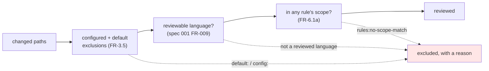

# Contract — Rule scope, and what the report says about it

**Feature**: [003 rule library](../spec.md) · **Date**: 2026-11-06
**Serves**: FR-011…FR-017, FR-021 · SRS FR-6.1a, FR-10.3b, FR-8.2e, AC-18

How the loaded rules decide what gets reviewed, and the observable consequences — the published schema's new value, the terminal's wording, and the outcome when nothing is left.

---

## 1 · The predicate

```
in scope of rule R   ⟺   any(R.include matches path) and not any(R.exclude matches path)
in review scope      ⟺   any(in scope of R) for R in library
```

Four properties, each one testable on its own:

| | |
|---|---|
| **Per rule, then unioned** | One rule's `exclude` narrows **that rule**. A file rule A excludes and rule B includes **is reviewed** |
| **An empty library excludes nothing** | With no rules loaded there is no rule to fail to match, so every file stays in scope |
| **The permissive default is universal** | A rule with no declared scope applies to every file, at every depth |
| **Reviewability comes first** | A file that is not a reviewed language is already out, and keeps its existing reason. Rule scope is asked only about files that would otherwise be reviewed |

The ordering in the last row matters more than it looks: a changed `README.md` must be reported as *not a reviewed language*, never as *no rule applies*. Two mechanisms must not offer competing explanations for one file.

---

## 2 · Where it is applied

At change-set resolution (CF-1), beside the configured exclusions, for the reason FR-3.5 already gives: no later stage should parse, execute against, or budget for a file that was never going to be reviewed.



The rules' scopes arrive as plain lists of pattern strings. CF-1 owns the matcher; the rule library owns the patterns and evaluates nothing.

---

## 3 · The published report

An excluded path's reason gains a third source:

| Reason | Meaning |
|---|---|
| `default:<name>` | A built-in exclusion rule matched — unchanged |
| `config:<pattern>` | A configured exclusion pattern matched — unchanged |
| **`rules:no-scope-match`** | **New.** No loaded rule's declared scope covers this file |

**This is a schema change.** The reason's pattern admits only `default:` and `config:` today, so the new value does not validate. Admitting it is an added value, which makes it a **minor** bump: `1.0` → `1.1`, hand-set, landing in the same change as the behaviour. Consumers that ignore unknown values are unaffected, which the schema's own documentation already requires of them.

A rule-scope exclusion is **not** a degradation. Nothing failed — a configured exclusion is not a degradation either, and this is the same kind of thing. A run whose only exclusions are of this kind reports an empty degradation list, and a test asserts exactly that.

---

## 4 · The terminal

The existing excluded-paths summary already prints a path with its reason, so the new value needs no new rendering. One addition: when any file was set aside for want of a rule, the summary says **how many**, so a reviewer sees it without reading the JSON.

---

## 5 · When nothing is left

| | |
|---|---|
| Outcome | The one *nothing reviewed* outcome, not a second one invented for this cause |
| The model | **Not called.** Zero provider requests |
| Verdict | **`nothing-to-review`** — its own verdict, already distinct from *reviewed and found nothing* in the verdict computation |
| Exit code | **0.** Nothing failed, so this is not the *no judgement made* case, which is where exit 2 belongs (a provider error, an exhausted budget). The distinction a reviewer needs is carried by the **verdict**, not the code |
| The report | Still written, naming every set-aside file and its reason |

This reuses behaviour that **does not exist yet**: feature 001's task T087 builds the *nothing reviewed* outcome, and this feature closes it. The conditional edge it adds must keep the pipeline graph acyclic, as T087 itself specifies.

---

## 6 · What AC-18 checks

Both clauses, because the first alone is satisfied by the implementation the second rules out:

1. A changed file no loaded rule covers is absent from the review, and appears in the stated scope with a reason distinguishable from a configured or default exclusion.
2. A file one rule excludes and another includes **is still reviewed**.
