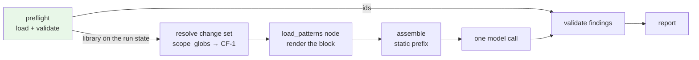

# Data Model — Feature 003, Rule Library

**Date**: 2026-11-06 · **Feature**: [spec.md](./spec.md) · **Research**: [research.md](./research.md)

What this feature adds to the system's types, and what it changes in existing ones. The authority for the shape of `PatternRule` and `PathScope` is [`Docs/design/02-domain-model.md`](../../Docs/design/02-domain-model.md) §3.8; this file records the feature-local detail that design leaves to implementation.

---

## 1 · Where each type lives

| Type | Package | Why there |
|---|---|---|
| `PathScope`, `PatternRule`, `PatternLibrary` | `core/patterns/` | CF-8's own types. A **Layer-1 capability**: it may import `core/findings/` and `core/config/` (Layer 0) and nothing else of ours |
| `Category`, `Severity` | `core/findings/` — **imported, not redefined** | One definition, not two. The catch predicate compares a finding's category with an expectation's, so a second vocabulary would be a silent scoring bug in feature 007 |
| The rule-scope filter | `core/changeset/` | CF-1 evaluates the globs ([research R-3](./research.md#r-3--cf-1-evaluates-the-globs-core-patterns-carries-them-as-data)); it receives plain string tuples and never imports `core/patterns/` |
| The configuration key | `core/config/` | Settings model, as every other key |

`core/patterns/` carries no type that reaches the published report. Only the rule **identifier** does, as a string already on a finding.

---

## 2 · New types

### `PathScope`

| Field | Type | Default | Validation |
|---|---|---|---|
| `include` | `tuple[str, ...]` | `("**/*",)` | Non-empty. Each entry a non-empty path pattern, POSIX separators only, no leading `/` |
| `exclude` | `tuple[str, ...]` | `()` | Same per-entry rules; the tuple itself may be empty |

Frozen, and unknown keys are rejected. An **empty `include`** is an error rather than a rule that applies to nothing — a rule that can never apply is certainly a mistake, and silently carrying it would make the library's size misleading.

**Patterns are not syntax-checked, because they cannot fail.** The dialect's translator accepts any string and produces a matcher; there are no invalid patterns, only patterns that match nothing. Validation therefore covers shape — non-empty, POSIX, not absolute — and stops there. Nobody should build a pattern validator, least of all in this package, which evaluates nothing.

### `PatternRule`

| Field | Type | Validation |
|---|---|---|
| `id` | `str` | A stable slug: lowercase alphanumerics separated by single hyphens. Unique within the loaded library |
| `title` | `str` | Non-empty. One line, for the prompt and the terminal |
| `category` | `Category` | From `core/findings/`'s vocabulary. A value outside it is an error naming the field |
| `default_severity` | `Severity` | From `core/findings/`'s vocabulary |
| `wrong` | `str` | Non-empty. The violating example |
| `correct` | `str` | Non-empty. The compliant counterpart |
| `applies_when` | `PathScope` | Defaults to the permissive scope when the key is absent |

Frozen; unknown keys rejected, so a misspelt key is an error and not a silent default.

**`default_severity` is a default, not a verdict.** A finding's severity stays the model's to choose within the existing vocabulary. The rule's value is what applies when nothing else says otherwise — this feature introduces no mechanism that overrides a model-set severity.

### `PatternLibrary`

| Member | Type | Notes |
|---|---|---|
| `rules` | `tuple[PatternRule, ...]` | **Sorted by `id`.** Determinism is the point: the rendered block must be byte-identical across runs (SC-004) |
| `source` | `str` | Which files it came from — the shipped set alone, or the shipped set plus the configured file. Reaches the run record (FR-028), never the report |
| `ids` | `frozenset[str]` | Derived. What a finding's identifier is validated against |
| `scope_globs` | tuple of `(include, exclude)` string tuples | Derived. **Plain builtins**, the seam that keeps CF-1 from importing this package |

---

## 3 · Deltas to existing types

| Where | Change | Consequence |
|---|---|---|
| The record of **what the run showed the model** | Its set of rule identifiers, which already exists and is always empty, is populated from the library | The rejection path for an unknown identifier becomes reachable for the first time |
| The prompt context | Gains the rendered rules block as its own field, rather than being concatenated into the instructions | SC-004's byte-identity check and the fixed-section constant both need the block addressable on its own |
| The excluded-path entry in the published report | Its reason admits a third source, `rules:no-scope-match` | **A minor schema-version bump**, `1.0` → `1.1`, in the same change. Hand-set, never derived from the package version |
| The finding model's rule-identifier field | Its description — prompt-visible, since the tool schema is generated from it — currently tells the model to leave it unset because no rules are loaded. It must say what to put there and when | A test asserts the old wording and changes with it |
| The settings model | One new key naming a file of additional rules | Absent key behaves as documented; unknown keys still rejected |
| The built-in instructions | Say the model is given the diff "and nothing else", which stops being true, and never mention citing a rule | Both the built-in text and the managed copy need it ([research R-2](./research.md#r-2--our-code-appends-the-rules-block-the-managed-prompt-never-holds-the-rules)) |

---

## 4 · The scope predicate

The one piece of logic worth stating as data rather than prose, because the obvious implementation is wrong:

```
a file is in scope of rule R   ⟺   any(R.include matches file) and not any(R.exclude matches file)
a file is in review scope      ⟺   any(file is in scope of R for R in library)
```

**Per rule, then unioned.** The failure mode to rule out is pooling the exclusions — `any(include over all rules) and not any(exclude over all rules)` — which lets a rule that skips `**/*.test.ts` remove test files from a rule written *for* them. AC-18's second clause exists to catch exactly this, and one unit test should have no purpose beyond failing for a pooled implementation.

An **empty library** puts every file in scope. Nothing is excluded on this ground when there is no rule to exclude it, which keeps an unloaded library from producing a correct-but-useless empty review.

---

## 5 · Lifecycle



Loaded once, validated once, then read three times: as globs by CF-1, as text by the prompt, as identifiers by validation. A malformed library never reaches any of the three — preflight is the only stage that may stop a run, and it stops there with the file and field named.
