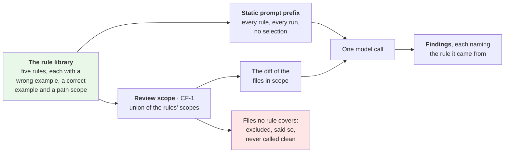

# Feature Specification: Rule Library — Scoped Rules in a Static Prompt

**Feature Branch**: `003-rule-library` *(a label: the spec directory's name. No branch is created by the workflow.)*

**Created**: 2026-11-06

**Status**: Draft

**Input**: User description: "Feature 3 — the rule library half of CF-8: a static pattern library shipped whole in the system prompt, path-scoped rules whose scope also determines review scope, and rule attribution on findings (SRS Appendix A step 3, part one)"

**Authority**: [`Docs/agentic-code-review-srs-v1.md`](../../Docs/agentic-code-review-srs-v1.md) is normative — **v1.8**, which added FR-6.1a and AC-18 for this feature's review-scope behaviour. This spec **selects** requirements from it and adds none. Design detail lives in [`Docs/design/`](../../Docs/design/), principally [`02-domain-model.md`](../../Docs/design/02-domain-model.md) §3.8. Where this file and those disagree, this file is wrong.

---

## What this feature delivers, in one picture

**In one sentence:** the reviewer gains a library of named rules it is always shown, those rules decide which files are worth reviewing, and every finding that comes from a rule says which one.

**What it deliberately does not prove:** that the rules are any good. Nothing here measures catch rate or false positives — that is feature **007**, and until it lands no claim that one rule set reviews better than another has evidence behind it (constitution Principle VI).

**Delivery order, declared.** The constitution requires a feature to say so when it pulls work forward: **002 (execution evidence, Appendix A step 2) has not started**, and this feature is step 3. Building it first is sound — CF-8's rule half needs nothing from CF-3 — but it is a departure, and it carries one concrete cost: 002 and 003 both edit the instructions text in `core/assembly/prompt.py` and both extend the record of what the run showed the model (002 adds check identifiers, 003 adds rule identifiers). Expect to reconcile those two by hand, and do not let either feature's tests assume it owns that text.

---

## Clarifications

### Session 2026-11-06

- Q: Does this feature deliver FR-6.1's "configurable" half, or only the shipped rules? → A: A **minimal additive config surface** — a configured rules file whose rules are added to the shipped ones, never replacing them. Overriding or narrowing a shipped rule stays v2. FR-6.1 is therefore complete, not partial.
- Q: FR-015 needs feature 001's task T087, which builds the `nothing-to-review` report and is still open. Who builds it? → A: **This feature completes T087** and records that in its tasks, rather than blocking on 001 or dropping the scenario.
- Q: What shape should the new excluded-path reason take, given the existing `default:<name>` and `config:<pattern>`? → A: The same **`<source>:<detail>`** shape — `rules:no-scope-match` — so the schema's pattern stays a rule rather than a list of exceptions.
- Q: Is AC-4 complete when verified with a scripted stand-in model, the corpus being feature 007? → A: **Yes, 003 claims AC-4.** A finding carrying its rule and an unknown identifier being rejected are both entirely ours and both testable offline; how often a real model cites a rule is 007's measurement.

---

## User Scenarios & Testing *(mandatory)*

### User Story 1 — A finding tells me which rule it came from (Priority: P1)

A reviewer reads a finding and wants to know whether it came from a rule the team agreed on or from the model's general judgement. A finding produced from a rule carries that rule's identifier, and the identifier is one the model was actually shown.

**Why this priority**: This is the feature's spine. The library reaching the prompt and the identifier surviving validation are what every other story builds on, and together they are the whole of AC-4.

**Independent Test**: In a fixture repository with one modified `.ts` file and a stand-in model that emits one finding citing a loaded rule's identifier and one citing nothing, run the review. Both findings appear; the first carries the rule identifier in the terminal and in the JSON, the second carries none.

**Acceptance Scenarios**:

1. **Given** a loaded library and a stand-in model that emits a finding naming one of its rules, **When** the review runs, **Then** the finding carries that rule's identifier in both outputs (AC-4).
2. **Given** the same run, **When** the JSON report is validated against the published schema, **Then** it validates and the rule identifier appears on the finding that named one.
3. **Given** a model that emits a finding naming no rule, **When** the review runs, **Then** the finding is accepted without a rule identifier and nothing is invented for it.

---

### User Story 2 — Five rules ship with the tool (Priority: P2)

A developer installs the tool and gets a working rule set without authoring anything. Each rule states what it is, what wrong looks like, what correct looks like, and which files it applies to.

**Why this priority**: FR-6.3a's floor. Without shipped rules the mechanism from Story 1 has nothing to carry, and the tool's first run would be indistinguishable from the build before this feature.

**Independent Test**: With no configuration present, load the library and assert at least five rules, each with a non-empty wrong example, correct example and declared scope, each with a unique identifier, and each category drawn from the finding model's vocabulary.

**Acceptance Scenarios**:

1. **Given** a fresh install and no configuration, **When** a review runs, **Then** at least five rules are in the prompt.
2. **Given** a rule file with a duplicated identifier, an unparseable path pattern, or a category outside the finding model's vocabulary, **When** the tool starts, **Then** it fails naming the rule and the field, **exits 3**, and no provider call is made.
3. **Given** the shipped library, **When** a change touches only test files, **Then** the change is still reviewed, because at least one shipped rule applies to test files.

---

### User Story 3 — A rule's scope decides what gets reviewed (Priority: P3)

A changed file that no rule applies to is not sent to the model. The run says which files it set aside and why, so a reviewer is never left to infer that silence meant approval.

**Why this priority**: The behaviour SRS v1.8 added FR-6.1a and AC-18 for. It is third because Stories 1 and 2 must exist for a scope to be the union of anything.

**Independent Test**: In a fixture repository where the shipped rules cover `.ts` but one changed file is a TS file every rule excludes, run the review. The covered file is reviewed, the excluded one is listed as set aside with a reason distinguishable from a configured exclusion, and the stated scope says so.

**Acceptance Scenarios**:

1. **Given** a change touching one file a rule applies to and one TS file no rule applies to, **When** the review runs, **Then** only the first is in the diff the model sees, and the second is reported as excluded for want of a rule (AC-18).
2. **Given** the same run, **When** the reasons are read, **Then** "no rule applies" is distinguishable from "a configured exclusion matched" and from "not a reviewed language".
3. **Given** a change in which **no** file is covered by any rule, **When** the review runs, **Then** the run completes, states that nothing was reviewed and why, and the verdict is **`nothing-to-review`** — a verdict of its own, distinct from *reviewed and found nothing*. Its **exit code is 0**: nothing failed, and the existing verdict-to-exit mapping already treats this outcome as a clean start rather than a clean *review*. *(Corrected 2026-11-06: this scenario said exit 2 and cited the "found nothing versus never looked" line. That line is about **no judgement being made** — a provider error or an exhausted budget — which is a different situation and is where exit 2 belongs.)*
4. **Given** a rule that excludes `**/*.test.ts` and another that applies to it, **When** a `.test.ts` file changes, **Then** it is in scope — one rule's exclusion does not remove a file from another rule's scope.

---

### User Story 4 — A rule identifier the run never loaded is rejected (Priority: P4)

A model that names a rule which does not exist has not applied a rule; it has guessed. The finding is treated as malformed rather than published with a fabricated provenance.

**Why this priority**: The negative half of AC-4, and the first time a path already written in the code becomes reachable. Small, but it is what makes the identifier on a finding worth trusting.

**Independent Test**: With a loaded library and a stand-in model emitting a finding whose rule identifier matches no loaded rule, run the review and assert the call is rejected with a message naming the offending identifier, and that the outcome is distinguishable from a review that found nothing.

**Acceptance Scenarios**:

1. **Given** a loaded library, **When** the model emits a finding naming an identifier no rule has, **Then** the call is rejected naming that identifier, and the rejection follows the same path as a malformed call (AC-13's machinery).
2. **Given** a library that failed to load or is empty, **When** the model emits a finding naming any rule, **Then** the identifier is discarded, the finding is kept, and the discard is recorded — a rejection would ask the model to correct something it cannot.

---

### User Story 5 — A project adds rules of its own (Priority: P5)

A team has a convention the shipped rules do not cover. They point the configuration at a rules file; those rules join the shipped ones, appear in the prompt, are valid identifiers for a finding to cite, and take part in deciding what gets reviewed.

**Why this priority**: FR-6.1 calls the library *configurable*, and it is a Must — so leaving it out would leave a Must half-delivered with no feature scheduled to finish it. It is last because the five shipped rules already make every other story true.

**Independent Test**: With a configured rules file holding one extra rule, run a review: the extra rule is in the prompt alongside the shipped five, a finding may cite it, and its scope widens what is reviewed. Point the configuration at a malformed file and the run stops at preflight naming the file and the field, with no provider call.

**Acceptance Scenarios**:

1. **Given** a configured rules file with one valid rule, **When** a review runs, **Then** the prompt holds the shipped rules **and** that rule, and a finding citing it is accepted.
2. **Given** a configured rule whose identifier matches a shipped rule's, **When** the tool starts, **Then** it fails naming the identifier — configured rules are added, never substituted, and an identifier means one rule.
3. **Given** a configured rules file that is malformed, unreadable or holds an unknown key, **When** the tool starts, **Then** it fails naming the file and the offending field and **exits 3**, with no provider call and no check execution.
4. **Given** no rules key in the configuration, **When** a review runs, **Then** the shipped library is used and nothing is reported as missing.
5. **Given** a configured rule whose scope covers a file the shipped rules do not, **When** a review runs, **Then** that file is reviewed — configured rules take part in the scope union like any other.

---

### Edge Cases

- **A renamed file**: scoped under its new path, consistent with how the change set already reports renames.
- **A file both covered and excluded by the same rule**: that rule does not apply to it; another rule still may.
- **A rule whose scope matches nothing in this change**: it stays in the prompt. The library is static; scope governs files, not which rules are shown.
- **An empty `include` list**: a rule that applies to nothing. Rejected at load as a certainly-mistaken rule rather than silently carried.
- **Non-TS/JS files**: already outside review (spec 001 FR-009), so they are reported under the existing language reason, not as "no rule applies". A file must be a reviewed language before the rule-scope question is asked.
- **A change set that is empty before rules are considered**: unchanged behaviour; this feature adds no new reason for it.

---

## Requirements *(mandatory)*

Each requirement names the SRS identifiers it delivers. *Partial* means the SRS requirement is only fully met once a later feature lands.

### Functional Requirements

**Loading the library**

- **FR-001**: The system MUST load the rule library before the change set is resolved, so that the rules' scopes are available to scope resolution. — *FR-6.1, FR-6.1a*
- **FR-002**: The system MUST ship at least five rules, each carrying an identifier, a title, a category, a default severity, a wrong example, a correct example, and a declared path scope. — *FR-6.3a*
- **FR-003**: Rule identifiers MUST be stable slugs, unique within the library. — *FR-6.2a*
- **FR-004**: The system MUST fail before any provider call, naming the rule and the offending field, when a rule is malformed, an identifier is duplicated, a category falls outside the finding model's vocabulary, a path pattern cannot be parsed, or a rule's include list is empty. — *(none — loud validation follows FR-1.2d's precedent for configuration; the SRS states no Must for rule-file validation)*
- **FR-005**: A library that cannot be loaded MUST stop the run at preflight rather than degrade it. — *FR-11.2 (preflight is the one stage that may halt)*

**What the model is given**

- **FR-006**: The system MUST include **every** loaded rule in the prompt on every review, with no per-run selection of a subset. — *FR-6.1, FR-5.3 (part — the execution-results half is 002)*
- **FR-007**: The rules MUST sit in the static, run-independent part of the prompt, ahead of all run-specific material, and the instructions-and-rules section MUST be a constant that does not vary with the change set. — *FR-2.5a (part)*
- **FR-008**: Each rule's declared scope MUST be stated to the model alongside that rule. — *FR-6.1a (part)*
- **FR-009**: The system MUST NOT shorten or drop the diff to make room for rules. Where the fixed sections and the diff together exceed the budget, the run MUST report budget exhaustion with nothing reviewed. — *FR-2.5b, FR-11.2*
- **FR-010**: The record of **what the run showed the model** MUST carry the rule identifiers it showed, so that a finding's identifier can be validated against them. — *FR-6.2a, FR-5.6a*

**Review scope**

- **FR-011**: A changed file MUST be in review scope when at least one loaded rule applies to it. A rule applies to a file when one of that rule's include patterns matches the file and none of that rule's exclude patterns does. — *FR-6.1a*
- **FR-012**: Exclude patterns MUST be evaluated per rule. One rule's exclusions MUST NOT remove a file from another rule's scope. — *FR-6.1a*
- **FR-013**: Review scope MUST be applied when the change set is resolved, so that no later stage parses, executes against, or budgets for a file that was never going to be reviewed. — *FR-6.1a, FR-3.5 (the same stage and reason, a different source)*
- **FR-014**: The resolved change set MUST record every file excluded for want of a rule, with a reason distinguishable from a configured exclusion and from a non-reviewed language, and both outputs MUST state it. The reason MUST take the same `<source>:<detail>` shape as the existing two. — *FR-6.1a, FR-10.3b, FR-8.2e*
- **FR-015**: Where review scope leaves no file, the run MUST complete, state that nothing was reviewed and why, and MUST NOT present the result as a clean review. This reuses the one *nothing reviewed* outcome rather than adding a second; **it closes feature 001's open task T087**, which builds that outcome. — *FR-6.1a, FR-11.2*
- **FR-016**: At least one shipped rule MUST apply to test files, so that a test-only change is not silently set aside. — *(none — a consequence of FR-6.1a and the prompt's existing `test-evidence` category; a project decision, not an SRS Must)*
- **FR-017**: Path patterns MUST use the same dialect and the same case sensitivity as the configured exclusion patterns. — *(none — consistency with FR-3.5's documented dialect)*

**Attribution**

- **FR-018**: A finding MUST be able to carry the identifier of the rule it came from, and MUST remain valid without one. — *FR-5.2, FR-6.2a*
- **FR-019**: The system MUST accept a rule identifier only when it names a rule shown to the model in that run, and MUST reject a finding naming any other identifier by the same path as a malformed call. — *FR-6.2a, FR-5.6a, FR-5.6c*
- **FR-020**: Where no rules were shown, a rule identifier on a finding MUST be discarded with the discard recorded, not rejected. — *FR-6.2a*
- **FR-021**: Both the terminal and the structured output MUST show a finding's rule identifier when it carries one. — *FR-6.2a, FR-8.1b, FR-8.2a*

**Structure and verification** *(tests are required by constitution Principle VII)*

- **FR-022**: Every test this feature adds MUST run offline, with no provider credential and a stand-in model. — *(none — constitution Principle VII)*
- **FR-023**: The layering import contract MUST be extended to cover the new rule-library package in this feature, not a later one. — *AC-10 (in spirit), (constitution Principle VII)*

**A project's own rules** *(added 2026-11-06 by clarification)*

- **FR-024**: The system MUST accept a configured path naming additional rules, and MUST behave as documented when the key is absent. — *FR-6.1, FR-1.2b, FR-1.2c*
- **FR-025**: Configured rules MUST be **added** to the shipped rules and MUST NOT replace them, following the precedent that a configured exclusion list merges rather than overrides. — *FR-6.1*
- **FR-026**: A configured rule whose identifier collides with a shipped rule's MUST fail, naming the identifier. Overriding or narrowing a shipped rule is not supported in v1. — *FR-6.1, FR-1.2d*
- **FR-027**: A malformed, unreadable or unknown-keyed configured rules file MUST fail at preflight, naming the file and the offending field, with no provider call and no check execution. — *FR-1.2d, FR-9.3*
- **FR-028**: The **invocation trace** MUST state the library's source — shipped only, or shipped plus the configured file — and how many rules were loaded. This is the trace FR-11.3 requires, **not** the published report: which rules were loaded is deliberately not a report field, pattern-coverage reporting being v2. — *FR-11.3*

### Traceability to the SRS

A scannable rollup of the trailing italic clause on each requirement above. `src/` and `tests/` cite the SRS column, never this feature's own IDs, per `CLAUDE.md`'s "requirement identifiers" convention — a bare `FR-` in code is always an SRS (`FR-x.y`) identifier.

| Feature ID | SRS ID(s) | Partial — what's missing, closed by | Realised in |
|---|---|---|---|
| FR-001 | FR-6.1, FR-6.1a | | `core/patterns/`, `core/pipeline/preflight.py` |
| FR-002 | FR-6.3a | | `core/patterns/` package data |
| FR-003 | FR-6.2a | | `core/patterns/` |
| FR-004 | *(none — loud validation, after FR-1.2d's precedent)* | | `core/patterns/` |
| FR-005 | FR-11.2 | | `core/pipeline/preflight.py` |
| FR-006 | FR-6.1, FR-5.3 | execution results in the prompt — **002** | `core/assembly/prompt.py` |
| FR-007 | FR-2.5a | related context and evidence sections — **002**, **004** | `core/assembly/prompt.py`, `core/assembly/budget.py` |
| FR-008 | FR-6.1a | | `core/assembly/prompt.py` |
| FR-009 | FR-2.5b, FR-11.2 | | `core/assembly/budget.py` |
| FR-010 | FR-6.2a, FR-5.6a | | `core/findings/port.py` |
| FR-011, FR-012 | FR-6.1a | | `core/changeset/exclusion.py` |
| FR-013 | FR-6.1a, FR-3.5 | | `core/changeset/resolve.py` |
| FR-014 | FR-6.1a, FR-10.3b, FR-8.2e | | `core/changeset/model.py`, `core/output/` |
| FR-015 | FR-6.1a, FR-11.2 | | `core/output/`, `core/pipeline/` |
| FR-016 | *(none — a project decision following from FR-6.1a)* | | `core/patterns/` package data |
| FR-017 | *(none — consistency with FR-3.5's dialect)* | | `core/changeset/exclusion.py` |
| FR-018 | FR-5.2, FR-6.2a | | `core/findings/model.py` |
| FR-019 | FR-6.2a, FR-5.6a, FR-5.6c | | `core/findings/validation.py` |
| FR-020 | FR-6.2a | | `core/findings/validation.py` |
| FR-021 | FR-6.2a, FR-8.1b, FR-8.2a | | `core/output/terminal.py`, `core/output/html.py`, `core/findings/report.py` |
| FR-022, FR-023 | *(none — constitution Principle VII)* | | `tests/`, `pyproject.toml` |
| FR-024 | FR-6.1, FR-1.2b, FR-1.2c | | `core/config/settings.py`, `core/patterns/` |
| FR-025, FR-026 | FR-6.1, FR-1.2d | | `core/patterns/` |
| FR-027 | FR-1.2d, FR-9.3 | | `core/pipeline/preflight.py` |
| FR-028 | FR-11.3 | | `core/pipeline/`, the run trace |

**No SRS parent**: FR-004, FR-016, FR-017, FR-022, FR-023 — loud rule-file validation, the test-file coverage floor, one glob dialect, and the two verification obligations. The first three are project decisions this spec records rather than requirements it invents; the last two come from the constitution, not the SRS.

**SRS IDs this feature completes**: FR-6.1 (both halves — the shipped library and the configurable one), FR-6.1a, FR-6.2a, FR-6.3a → **AC-4**, **AC-18**. AC-4 is claimed on the strength of offline verification: a finding carrying its rule, and an identifier the model was not shown being rejected. How often a real model cites a rule is a measurement, and measurement is **007**.

**SRS IDs it advances but does not complete**: FR-5.3 (the CF-3 half is 002), FR-2.5a (the related-context and evidence sections arrive with 004 and 002), FR-5.2 (the rule-identifier clause only).

A future feature's own traceability subsection follows this same shape, in its own `specs/NNN-*/spec.md`.

### Deliberately not in this feature

| Not delivered | SRS | Arrives in |
|---|---|---|
| The regression corpus, the catch rate, the false-positive figure, the catch predicate, the `regression` command and its flags | FR-6.2b, FR-6.2d, FR-6.2e, FR-6.2f, AC-5 | **007** regression harness |
| Any measurement of whether these rules work, or whether the prompt wording helps | FR-6.2d, TBD-6 | **007** |
| **Overriding or narrowing a shipped rule**, and any precedence order between built-in and user rules. Configured rules are added only (FR-025) | FR-6.1 (delivered); override is beyond it | **v2** |
| Reporting which rules fired, as coverage, in the structured output | FR-6.2c | **v2** |
| A broad default rule set beyond the five | FR-6.3 | **v2** |
| Execution evidence in the prompt, and findings citing a check result | FR-4.x, AC-2, AC-7 | **002** execution evidence |
| Related context, achieved depth, the parser and the resolver | FR-2.x, AC-1, AC-3, AC-6, AC-8, AC-10, AC-12, AC-14 | **004** context quality |
| The `schema` command | *(none here — it is **spec 001 FR-028**, qualified per `CLAUDE.md`, and not to be confused with this feature's own FR-028)* | **001**, task T092 |

### Key Entities

- **Pattern rule** — a named, categorised "wrong versus correct" pair with a default severity and a declared path scope. Identified by a stable slug a finding can cite.
- **Path scope** — the include and exclude patterns that say which files a rule applies to. The union of the library's scopes is the review scope.
- **Exclusion reason** — why a changed file is not being reviewed. This feature adds a third kind, beside a configured exclusion and a non-reviewed language, and the three must stay distinguishable.

---

## Success Criteria *(mandatory)*

### Measurable Outcomes

- **SC-001**: **At least five** rules ship and load with no configuration present, **100%** of them carrying an identifier, a category, both examples and a declared scope.
- **SC-002**: **100%** of findings that carry a rule identifier name a rule the run showed the model; **0** findings reach a report naming a rule that was not loaded.
- **SC-003**: A change whose files no rule applies to completes, names **every** set-aside file with a reason, and is **never** reported as clean.
- **SC-004**: The instructions-and-rules portion of the prompt is **byte-identical** across two runs over different change sets in the same configuration.
- **SC-005**: A test-only change is reviewed rather than set aside, with the shipped library and no configuration.
- **SC-006**: The full test suite still runs **offline with no credential**, and the layering contract covering the new package passes in the same change that creates it.
- **SC-007**: A malformed rule file stops the run with the rule and field named, **before** any provider call — **0** credential uses and **0** check executions on that path.
- **SC-008**: A project that configures one extra rule gets **all five shipped rules plus that one** in the prompt, and **0** shipped rules are displaced.

---

## Assumptions

- **The category vocabulary is the finding model's**, the one FR-5.2b already defines and the finding schema already enforces. Rules do not introduce categories of their own. The vocabulary itself is still recorded as an open item ([DB-08](../../DESIGN_BLOCKERS.md#db-08)); this feature consumes it and does not settle it.
- **The path dialect is the one already documented for configured exclusions** (FR-3.5): `**` spans whole path segments, `*` and `?` stay within one, a pattern with no separator matches at any depth, patterns match the whole repo-relative path, and matching is case-sensitive.
- **Severity on a rule is a default, not a verdict.** A finding's severity remains the model's to set within the existing vocabulary; the rule's value is what applies when nothing else says otherwise.
- **Non-TS/JS files are already out of review** (spec 001 FR-009), so rule scope narrows an already-narrowed set. This is why FR-014 insists the reasons stay distinguishable.
- **Prompt caching is an unverified benefit.** A static prefix is the precondition for it, not evidence of it; no claim about latency or cost rests on it in this feature ([`02-domain-model.md`](../../Docs/design/02-domain-model.md) §3.8).
- **The library ships with the tool**, so the five rules are available on a fresh install with no repository configuration and no network.
- **This feature completes feature 001's task T087, and less is missing than that suggests.** The `nothing-to-review` outcome mostly exists: it is a completion status and a verdict in the finding model, the verdict computation returns it, the terminal has its wording, and the exit-code table maps it to 0. What does **not** exist is anything that ever *sets* it — no route produces that status, because the only conditional edges today are preflight's and the budget's. T087 is that route: when no reviewable file remains, skip assembly and the review and build the report. 003 builds it and marks T087 closed in 001's task list, rather than inventing a second outcome for the same situation. It is the one place this feature touches the pipeline's routing, which is otherwise 001's territory.
- **The managed system prompt holds a copy of the instructions text.** When the prompt store is configured, the system message comes from it rather than from the built-in fallback. Both get the rules block appended by our code, so rules are always present — but the *instructions* served from the store will not mention rules until that stored prompt is republished. That is an operational step, not a code change, and it belongs in this feature's task list.

---

## Design gaps raised by this spec

Three of the five gaps this spec first raised were settled by the 2026-11-06 clarification session above — **D-1** (configured rules are added, never substituted; override is v2), **D-3** (the empty scope reuses the one *nothing reviewed* outcome, and this feature builds it) and the open half of **D-5** (the reason keeps the `<source>:<detail>` shape). What remains:

- **D-2 — in what form rule files are written.** [`06-verification.md`](../../Docs/design/06-verification.md) §2 was corrected on 2026-11-06 to put the shipped library in `core/patterns/` as package data rather than under the corpus, so *where* is settled. The format is a plan decision, bounded by the rule that design introduces no technology: if a format implies a dependency the project does not already carry, the plan raises it for [`technical_stack.md`](../../Docs/technical_stack.md) rather than choosing it.
- **D-4 — the scope statement's shape.** FR-014 requires the three exclusion reasons to stay distinguishable in both outputs. Whether that is one list with a reason column or three counts is a reporting decision for the plan.
- **D-5 (remainder) — the schema version bump.** The report's excluded-path entry constrains its reason to `default:<name>` or `config:<pattern>`, so a third source does not validate today. Admitting `rules:<detail>` is an added value, which [`02-domain-model.md`](../../Docs/design/02-domain-model.md) §4 makes a **minor** bump — the first this project has taken. It must land in the same change as the behaviour, with the tests that assert the version. FR-014 is not deliverable without it. The design doc's own literal for this reason needs correcting to match (it reads `no-rule-scope`).
