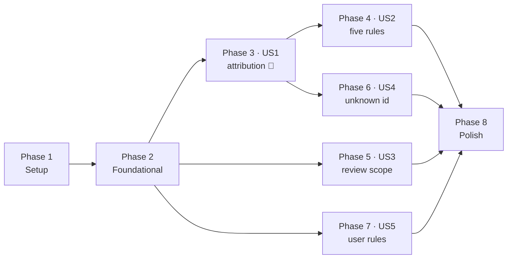

# Tasks: Rule Library — Scoped Rules in a Static Prompt

**Input**: Design documents from `specs/003-rule-library/`

**Prerequisites**: [plan.md](./plan.md), [spec.md](./spec.md), [research.md](./research.md),
[data-model.md](./data-model.md), [contracts/](./contracts/), [quickstart.md](./quickstart.md)

**Tests**: **Required.** Constitution Principle VII and spec FR-022/FR-023 make tests part of the feature. The
task template's "tests are optional" line does not apply here — the constitution's own sync note says a feature
spec must state the requirement explicitly, and this one does. Within each phase, test tasks come first and are
expected to fail until the implementation tasks after them land.

**Authority**: these tasks select from the documents above and add no requirement. A task that seems to need a
decision the documents do not make stops and reports it (Principle I) — it is not settled inside the code.

**Organization**: grouped by user story (spec.md priorities P1–P5), so each story is a testable increment.

## Format: `[ID] [P?] [Story] Description`

- **[P]** — parallelisable: a different file, with no dependency on an unfinished task.
- **[US1]…[US5]** — the user story the task serves. Setup, foundational and polish tasks carry no story label.
- Paths are repo-relative. `src/` means `src/agentic_review/`.

## Rules that apply to every task

**Offline.** Every test runs with no provider credential and the scripted stand-in model in
`tests/support/`. Nothing in this feature may require a network call to pass.

**No quality claims.** No task is justified by "this reviews better". Whether these rules improve review is
feature 007's question (Principle VI). In particular: **no test may assert the rules block fits inside a token
count**, because the budget it would be measured against is an acknowledged placeholder.

**One glob dialect.** `core/changeset/exclusion.py` owns the translator. `core/patterns/` carries patterns as
data and evaluates none. If a task seems to need a matcher inside `core/patterns/`, it is the wrong task —
see [research R-3](./research.md).

**Field names.** `snake_case` in Python, `camelCase` in every serialised surface, including rule files.

**Two tasks edit feature 001's files, deliberately.** **T046** completes 001's open **T087** — the route that
produces the `nothing-to-review` status, which nothing sets today even though the verdict, its wording and its
exit code all exist. When T046 lands, tick T087 in `specs/001-walking-skeleton/tasks.md` and say so in the
commit: an open task that is secretly done is worse than one that is open. **T014** documents the new
configuration key in `specs/001-walking-skeleton/contracts/config.md`, because that file is the configuration
contract for the whole tool rather than for one feature; add a dated note there rather than rewriting it.
No other task touches another feature's files.

---

## Phase 1: Setup (shared infrastructure)

**Purpose**: the package and test directories everything else lands in.

- [X] T001 Create `src/agentic_review/core/patterns/__init__.py` exporting the public surface named in [data-model.md](./data-model.md) §2 — `PathScope`, `PatternRule`, `PatternLibrary`, `load_library`, `PatternLibraryError`, `rules_block` — with a module docstring stating that this package carries rules as **data** and evaluates no globs (research R-3)
- [X] T002 [P] Create `src/agentic_review/core/patterns/rules/__init__.py` so the shipped rule documents are an addressable package for `importlib.resources`, with a docstring saying these files are package data read at runtime and never by path arithmetic from `__file__` (technical_stack §3.1)
- [X] T003 [P] Create `tests/unit/patterns/__init__.py`

**Checkpoint**: `uv run python -c "import agentic_review.core.patterns"` succeeds.

---

## Phase 2: Foundational (blocking prerequisites)

**⚠️ CRITICAL**: every user story depends on this phase. Nothing in Phase 3 or later works until the library
loads, renders and validates.

### `core/patterns/` — the types

- [X] T004 [P] Write `tests/unit/patterns/test_model.py`: `PathScope` defaults to `include=("**/*",)` and empty `exclude`; an empty `include` list is rejected; a leading `/` is rejected; a Windows separator is rejected; unknown keys are rejected; the model is frozen ([data-model.md](./data-model.md) §2, FR-004)
- [X] T005 [P] Extend `tests/unit/patterns/test_model.py`: `PatternRule` requires `id`, `title`, `category`, `defaultSeverity`, `wrong`, `correct`; a non-slug `id` is rejected; a `category` outside the finding model's vocabulary is rejected; an empty `wrong` or `correct` is rejected; `appliesWhen` defaults to the permissive scope; unknown keys are rejected (FR-002, FR-003, FR-004)
- [X] T006 Implement `src/agentic_review/core/patterns/model.py`: `PathScope` and `PatternRule` as frozen Pydantic models with `extra="forbid"` and `camelCase` aliases, **importing `Category` and `Severity` from `core/findings/`** rather than restating them — one definition, and feature 007's catch predicate compares categories across both (FR-002, FR-003)
- [X] T007 Add `PatternLibrary` to `src/agentic_review/core/patterns/model.py`: a frozen dataclass holding `rules` **sorted by `id`**, a `source` string, and derived `ids` (a `frozenset[str]`) and `scope_globs` (a tuple of `(include, exclude)` **plain builtin string tuples** — the seam that keeps CF-1 from importing this package) ([data-model.md](./data-model.md) §2, research R-3)

### `core/patterns/` — loading and validation

- [X] T008 [P] Write `tests/unit/patterns/test_library.py` for the failure table in [contracts/rules-file.md](./contracts/rules-file.md) §3: a missing file, invalid YAML, a top level that is not a mapping with `rules`, a rule that is not a mapping, a missing required field, an unknown key, a bad identifier, a category outside the vocabulary, an empty include list, an absolute pattern, and a duplicate identifier — each raising `PatternLibraryError` whose message names the **file and the offending field**, with the rule's index or identifier (FR-004, FR-026)
- [X] T009 Implement `src/agentic_review/core/patterns/library.py`: `PatternLibraryError` and `load_library(extra: Path | None = None) -> PatternLibrary`, reading the shipped `*.yml` in sorted name order through `importlib.resources`, parsing with `yaml.safe_load` (never `load`), validating each document against `PatternRule`, then applying the library-level checks `PatternRule` cannot make — identifiers unique, at least one rule, POSIX separators only (FR-001, FR-004, research R-1)
- [X] T010 Add a test to `tests/unit/patterns/test_library.py` asserting **patterns are not syntax-validated**: a pattern that matches nothing loads without error, because the dialect's translator accepts any string. This test exists to stop someone building a pattern validator — which would have to live in the wrong package ([data-model.md](./data-model.md) §2)

### `core/patterns/` — rendering

- [X] T011 [P] Write `tests/unit/patterns/test_render.py`: `rules_block` is deterministic for a given library (same bytes twice), orders rules by `id`, contains every `id` **verbatim**, and states each rule's declared scope next to it ([contracts/rules-file.md](./contracts/rules-file.md) §4)
- [X] T012 Implement `src/agentic_review/core/patterns/render.py`: `RULES_HEADING` and `rules_block(library) -> str`, rendering each rule's identifier, title, category, default severity, declared scope, wrong example and correct example

### `core/config/` — the configuration key

- [X] T013 [P] Extend `tests/unit/config/test_settings.py`: a `patterns.rules` path validates; the key absent is not an error; an unknown key under `patterns` is rejected (FR-024)
- [X] T014 Add the `patterns` section with its `rules` path to `src/agentic_review/core/config/settings.py`, and document it in `specs/001-walking-skeleton/contracts/config.md` with a dated note pointing at [contracts/rules-file.md](./contracts/rules-file.md) §1 (FR-024)

### `core/pipeline/` — loading at preflight

- [X] T015 [P] Extend `tests/unit/pipeline/test_preflight.py`: a valid library lands on the preflight result; a malformed configured rules file is a preflight **failure** naming the file and field with **exit 3** and **no provider call**; a configured file that does not exist fails the same way; no key configured loads the shipped library alone (FR-005, FR-027)
- [X] T016 Load and validate the library in `src/agentic_review/core/pipeline/preflight.py`, putting it on the preflight result. Preflight is the only stage that may stop a run, which is why the load belongs here and not in the `load_patterns` node — and CF-1 needs the scopes before it resolves (research R-7)

### Structural contracts

- [X] T017 Add `agentic_review.core.patterns` to `pyproject.toml`: contract 6's layer list **as a sibling of `agentic_review.core.changeset`** (`"agentic_review.core.changeset | agentic_review.core.patterns"`), and as a source module in contracts 1, 2 and 8. Contract 3 already covers it through its `agentic_review.core` wildcard. Principle VII requires this in the same feature that creates the package (research R-10)
- [X] T018 [P] Write `tests/structural/test_pattern_dialect_confinement.py` in the shape of `test_git_confinement.py`: no module under `core/patterns/` compiles a path pattern or defines a glob translator. The layering contract catches the *import*; this catches a copy-paste of the dialect (research R-3)

**Checkpoint**: `uv run lint-imports` passes with the new package in contract 6, and `core/changeset/` importing `core/patterns/` is a **violation**. The library loads, renders deterministically, and a bad rules file stops the run at preflight.

---

## Phase 3: User Story 1 — A finding tells me which rule it came from (Priority: P1) 🎯 MVP

**Goal**: the library reaches the model, and a finding produced from a rule carries that rule's identifier all the way to both outputs.

**Independent Test**: in a fixture repository with one modified `.ts` file and a stand-in emitting one finding citing a loaded rule and one citing nothing, both findings appear; the first carries the identifier in the terminal and the JSON, the second carries none.

### Tests for User Story 1 ⚠️ write first

- [X] T019 [P] [US1] Extend `tests/unit/assembly/test_prompt.py`: the rules block lands in the **system** message and not the user message; the system message is the instructions followed by the block; passing no library reproduces today's behaviour exactly (FR-006, FR-007, research R-2)
- [X] T020 [P] [US1] Extend `tests/unit/assembly/test_prompt.py`: the whole-prompt token estimate **includes** the rules block, and the new fixed-section function returns the instructions-plus-rules size (FR-009, research R-8)
- [X] T021 [P] [US1] Extend `tests/unit/assembly/test_prompt.py`: the record of what the run showed the model carries the library's rule identifiers (FR-010)
- [X] T022 [P] [US1] Extend `tests/unit/findings/test_validation.py`: a finding citing a loaded identifier keeps it; the identifiers come from a real loaded library rather than a hand-built set (FR-018, FR-019)
- [X] T023 [P] [US1] Extend `tests/unit/findings/test_schema.py`: the rule-identifier field's description no longer tells the model to leave it unset, and the published schema still validates (FR-018)
- [X] T024 [P] [US1] Write `tests/integration/test_story1_rule_attribution.py`: a review whose stand-in emits one finding citing a shipped rule and one citing nothing — the first shows its rule in the terminal, the JSON and the HTML, the second shows none, and the JSON validates against the published schema (FR-021, **AC-4**)

### Implementation for User Story 1

- [X] T025 [US1] Add the rules block to the prompt in `src/agentic_review/core/assembly/prompt.py`: a `system_message(instructions, rules_block)` helper joining them in a fixed order, `prompt_text` and `assemble` taking the library, and the review context carrying `rules_block` as **its own field** rather than pre-concatenated — SC-004's byte-identity check and the fixed-section constant both need it addressable ([data-model.md](./data-model.md) §3, research R-2)
- [X] T026 [US1] Add `fixed_section_tokens(instructions, rules_block)` to `src/agentic_review/core/assembly/budget.py`, and route the rules block through the existing whole-prompt estimate so rules cannot beat the budget by being uncounted. Build **no** per-section allocation and no eviction: FR-2.5a's per-section budgeting is feature 004's (research R-8)
- [X] T027 [US1] Populate the rule identifiers on the record of what the run showed the model — the material object in `src/agentic_review/core/findings/port.py` — and pass the library from the `load_patterns` node through to `assemble` (FR-010)
- [X] T028 [US1] Turn `_load_patterns` in `src/agentic_review/agents/pipeline_agent.py` from a pass-through into the thin adapter its siblings are: render the block, publish the identifiers, write both onto the run state, and pass them to `_assemble_context`. **The node keeps its place and the graph's edges do not move** (research R-7)
- [X] T029 [US1] Rewrite the rule-identifier field's description in `src/agentic_review/core/findings/model.py`. It currently reads "Leave unset. No pattern rules are loaded, so any value here is discarded." — **prompt-visible text**, since the tool schema is generated from this model. It must say what to put there and when to omit it (FR-018)
- [X] T030 [US1] Update the built-in instructions in `src/agentic_review/core/assembly/prompt.py`: the sentence saying the model is given the diff "and nothing else" is now false, and nothing tells the model to cite a rule. Add that the rules are guidance to apply, not a checklist to work through, and that a finding from a rule should carry its identifier (FR-006, FR-008)
- [X] T031 [US1] Name the fixed section's share in the budget-exhaustion detail in `src/agentic_review/agents/pipeline_agent.py`, so a run that no longer fits says what is taking the room (research R-8)

**Checkpoint**: AC-4 passes offline. A finding names its rule, in every output.

---

## Phase 4: User Story 2 — Five rules ship with the tool (Priority: P2)

**Goal**: a fresh install has a working rule set, each rule scoped to what it applies to.

**Independent Test**: with no configuration, load the library and assert at least five rules, each with both examples, a unique identifier, a category from the vocabulary, and a declared scope — at least one of which covers test files.

### Tests for User Story 2 ⚠️ write first

- [X] T032 [P] [US2] Write `tests/unit/patterns/test_shipped_rules.py`: the shipped library loads with **no configuration**; it holds **at least five** rules; every rule has a non-empty `wrong` and `correct`, a slug identifier, a category in the vocabulary and a declared scope; identifiers are unique (FR-002, **SC-001**)
- [X] T033 [P] [US2] Extend `tests/unit/patterns/test_shipped_rules.py`: the union of the shipped scopes covers an ordinary `src/thing.ts`, **and at least one shipped rule applies to a test file** such as `src/thing.test.ts` — the guardrail in FR-016, which exists because the instructions ask for findings about tests that were weakened or never written (research R-9, **SC-005**)
- [X] T034 [P] [US2] Write `tests/unit/patterns/test_packaging.py`: `load_library()` succeeds against the **installed** distribution, not just the source tree, so a wheel that forgot the package data fails here rather than in a user's install (research R-1)

### Implementation for User Story 2

- [X] T035 [US2] Author the five shipped rules as YAML under `src/agentic_review/core/patterns/rules/`, drawn from the categories the instructions already name, each with a real TypeScript wrong/correct pair in block scalars, each narrowly scoped, and **at least one applying to test files**. Scope them narrowly *within* TS/JS and never narrower — the union must cover an ordinary source file (FR-002, FR-016, research R-9)
- [X] T036 [US2] Record the rule count and the library's source — shipped alone, or shipped plus the configured file — on the preflight result in `src/agentic_review/core/pipeline/preflight.py`, beside the library T016 loads. Every tracer attached to the graph ships pipeline state, so this is what puts it in the trace FR-11.3 requires. **Add no field to `RunMetadata` in `src/agentic_review/core/findings/report.py`**: that is the *published report's* run record, and which rules were loaded is deliberately not a v1 report field — pattern-coverage reporting is v2, and a field there would be a second schema change this feature has no requirement for (FR-028)

**Checkpoint**: a fresh install reviews with five rules and no configuration.

---

## Phase 5: User Story 3 — A rule's scope decides what gets reviewed (Priority: P3)

**Goal**: FR-6.1a. A changed file no rule covers is not sent to the model, and the run says which files it set aside and why.

**Independent Test**: a fixture repository with one covered file and one TS file every rule excludes — the covered one is reviewed, the other is listed as set aside with a reason distinguishable from a configured exclusion, and the stated scope says so.

### Tests for User Story 3 ⚠️ write first

- [X] T037 [P] [US3] Write `tests/unit/changeset/test_rule_scope.py` with **the pooling-bug test first**: a file one rule excludes and another includes **is in scope**. A pooled implementation — `any(include over all rules) and not any(exclude over all rules)` — must fail this test and nothing else should be written until it does ([data-model.md](./data-model.md) §4, **AC-18** clause 2)
- [X] T038 [P] [US3] Extend `tests/unit/changeset/test_rule_scope.py`: a file outside every include is out of scope; an empty scope list puts **every** file in scope; the permissive default matches at every depth; matching is case-sensitive; patterns match repo-relative POSIX paths on Windows too (FR-011, FR-012, FR-017)
- [X] T039 [P] [US3] Extend `tests/unit/changeset/test_rule_scope.py` for the ordering in research R-4: a file that is **not a reviewed language** keeps its existing reason and is **not** relabelled as a rule-scope exclusion; a file already excluded by a configured or default pattern keeps **that** reason. Three mechanisms, three distinguishable explanations, no competition for one path (FR-014)
- [X] T040 [P] [US3] Extend `tests/unit/findings/test_schema.py`: the excluded-path reason accepts `rules:no-scope-match`, still rejects a malformed reason, and the schema version is `1.1` (FR-014, research R-5)
- [X] T041 [P] [US3] Extend `tests/unit/output/test_render.py`: the terminal summary states **how many** files no rule covered, and renders the new reason. Also extend `tests/unit/output/test_verdict.py`: an empty review scope computes the `nothing-to-review` verdict, which the existing mapping already exits **0** on — not the *no judgement* verdict, which exits 2 (FR-014, FR-015, FR-021)
- [X] T042 [US3] Write `tests/integration/test_story3_rule_scope.py`: the covered file is in the prompt the stand-in received and the uncovered one is not; the JSON's excluded list carries `rules:no-scope-match`; **the degradation list is empty**, which is the executable form of "a scope exclusion is not a degradation" ([contracts/rule-scope.md](./contracts/rule-scope.md) §3, **AC-18** clause 1)
- [X] T043 [US3] Extend `tests/integration/test_story3_rule_scope.py`: when **no** file is in scope, the run completes, says nothing was reviewed and why, calls the stand-in **zero** times, writes a JSON report, and the verdict is **`nothing-to-review`** at **exit 0** — distinguishable from an empty change set and from a review that found nothing. Assert the verdict, not the exit code alone: 0 is shared with a clean review, and the verdict is what tells them apart (FR-015, **SC-003**)

### Implementation for User Story 3

- [X] T044 [US3] Add the scope predicate to `src/agentic_review/core/changeset/exclusion.py`: a `RuleScope` alias over plain string tuples, the `rules:no-scope-match` reason constant, and `in_any_rule_scope(path, scopes)` as `any(any(include) and not any(exclude))` — **per rule, then unioned**. Reuse the existing `glob_to_regex`; add no second translator (FR-011, FR-012, FR-017)
- [X] T045 [US3] Apply the filter in `src/agentic_review/core/changeset/resolve.py` at the end of collection, **after** the configured exclusions and **after** the reviewable-language test, moving a dropped file into the excluded list with its reason. Thread `rule_scopes` with a default of `()` through `resolve`, `diff_branches` and the collection helper, and through the pull-request source's method — a widening recorded as design gap **D-6** (FR-013, FR-014, research R-4)
- [X] T046 [US3] Build the *nothing reviewed* short-circuit in `src/agentic_review/agents/pipeline_agent.py`: when no reviewable file remains, skip assembly and the review and build that report, as a **conditional edge** so the graph stays acyclic and the skip is visible. **This completes feature 001's T087** — tick it there and say so in the commit (FR-015)
- [X] T047 [US3] Widen the excluded-path reason pattern in `src/agentic_review/core/findings/report.py` to admit the `rules:` source, and bump `SCHEMA_VERSION` from `1.0` to `1.1` in `src/agentic_review/core/findings/schema.py` **in the same change**. Hand-set, never derived from the package version. Update every test asserting `"1.0"` (FR-014, research R-5)
- [X] T048 [US3] Pass the library's `scope_globs` from the preflight result into change-set resolution in `src/agentic_review/agents/pipeline_agent.py` — plain glob lists, so `core/changeset/` never imports `core/patterns/` and contract 6 stays satisfied (FR-013, research R-3)
- [X] T049 [US3] Add the rule-dropped count to the terminal summary in `src/agentic_review/core/output/terminal.py` (FR-021)

**Checkpoint**: AC-18 passes, both clauses. A file no rule covers is set aside, said so, and an empty scope is never clean.

---

## Phase 6: User Story 4 — A rule identifier the run never loaded is rejected (Priority: P4)

**Goal**: an identifier the model was not shown cannot reach a report. The rejection path already exists in the code and has never been reachable.

**Independent Test**: with a loaded library and a stand-in emitting a finding whose identifier matches no rule, the call is rejected naming that identifier, and the outcome is distinguishable from a review that found nothing.

### Tests for User Story 4 ⚠️ write first

- [ ] T050 [P] [US4] Extend `tests/unit/findings/test_validation.py`: with rules loaded, a finding citing an unknown identifier is rejected with a message naming it, by the same path as a malformed call; with **no** rules loaded, the identifier is **discarded** with the discard recorded and the finding kept — a rejection would ask the model to correct something it cannot (FR-019, FR-020)
- [ ] T051 [US4] Write `tests/integration/test_story4_unknown_rule.py`: a stand-in whose only call cites an unknown identifier produces a repair turn; where the repair also fails, the outcome is distinguishable from a review that found nothing (FR-019)

### Implementation for User Story 4

- [ ] T052 [US4] Make the dangling-identifier branch in `src/agentic_review/core/findings/validation.py` reachable now that identifiers are published, keeping the existing discard path for the no-rules case. Keep the discard note string: removing a model-visible contract string costs more than a tested branch that production no longer reaches (FR-019, FR-020)

**Checkpoint**: every identifier that reaches a report names a rule the model demonstrably saw.

---

## Phase 7: User Story 5 — A project adds rules of its own (Priority: P5)

**Goal**: FR-6.1's "configurable" half. A configured rules file's rules join the shipped ones.

**Independent Test**: with a configured file holding one extra rule, that rule is in the prompt alongside the shipped five, is a valid identifier to cite, and takes part in the scope union; a malformed file stops the run at preflight.

### Tests for User Story 5 ⚠️ write first

- [ ] T053 [P] [US5] Extend `tests/unit/patterns/test_library.py`: configured rules are **added** to the shipped ones with none displaced; a configured identifier colliding with a shipped one fails naming the identifier; the library's `source` names both origins (FR-025, FR-026, FR-028, **SC-008**)
- [ ] T054 [US5] Write `tests/integration/test_story5_user_rules.py`: the configured rule appears in the prompt beside all five shipped rules; a finding may cite it; a file only its scope covers **is** reviewed; a malformed configured file exits 3 with **zero** provider calls (FR-024, FR-025, FR-027, **SC-007**)

### Implementation for User Story 5

- [ ] T055 [US5] Extend `load_library` in `src/agentic_review/core/patterns/library.py` to read the configured file and append its rules, rejecting an identifier that collides with a shipped one. Additive only — overriding or narrowing a shipped rule is v2 (FR-025, FR-026, research R-6)
- [ ] T056 [US5] Pass the configured path from settings into the preflight load in `src/agentic_review/core/pipeline/preflight.py` (FR-024)

**Checkpoint**: FR-6.1 is complete, both halves.

---

## Phase 8: Polish & cross-cutting concerns

- [ ] T057 [P] Republish the managed system prompt so its instructions match T030's text. **Not a code change, and the easiest thing here to forget**: without it, every run with the prompt store configured shows rules the instructions never mention (research R-2)
- [ ] T058 [P] Update `Docs/operation_guidelines.md` with the rules file, the `patterns.rules` key, and what "no rule applies" means in a report — it describes what the code does today, so it changes when the code does
- [ ] T059 [P] Update `Docs/design/01-logical-architecture.md` §2.2's component table to mark `core/patterns/` as populated, and `Docs/technical_stack.md` §4's layout tree likewise
- [ ] T060 [P] Record design gaps **D-6** (the widened pull-request interface) and **D-7** (how much of the library the trace carries) in `DESIGN_BLOCKERS.md`, with their resolution as taken in [plan.md](./plan.md)
- [ ] T061 Update `CLAUDE.md`: the module count, the test count, and that CF-8's rule half is built while the harness half is feature 007
- [ ] T062 Update `specs/README.md` to mark 003 in progress
- [ ] T063 Run `uv run python -m pytest` and `uv run lint-imports` (or the Windows fallbacks in `CLAUDE.md`) and confirm the suite is green offline with no credential, and that contracts report 0 broken

---

## Dependencies & Execution Order



### Phase dependencies

- **Phase 2 blocks everything.** No story works until the library loads and renders.
- **US1 and US3 are independent of each other** and are the two halves of the feature: one changes what a review *says*, the other what it *looks at*.
- **US2 needs US1** only so the shipped rules have a prompt to arrive in; US1's own tests use fixture rules.
- **US4 needs US1**, since publishing the identifiers is what makes the rejection path reachable.
- **US5 needs Phase 2** alone, and can be built at any point after it.

### Within each phase

Tests first, then implementation. In Phase 5 the order is stricter: **T037 before anything else in the phase**, because the pooling bug is easiest to write and hardest to notice.

### Parallel opportunities

- Phase 1: T002 and T003 together.
- Phase 2: T004, T005, T008, T011, T013, T015 and T018 are different files and can be written together; their implementations serialise where they share a module.
- Phase 3: T019–T024 together.
- Phase 5: T037–T041 together, then T042 and T043.
- Phase 8: T057–T060 together.

## Parallel Example: User Story 1

```
T019, T020, T021   # tests/unit/assembly/test_prompt.py — separate assertions, one file, write together
T022, T023         # tests/unit/findings/ — different files
T024               # tests/integration/test_story1_rule_attribution.py
```

## Implementation Strategy

### MVP first (User Story 1 only)

Phases 1–3 deliver **AC-4** and the feature's spine: the library in the prompt, identifiers published, a finding naming its rule. That is demonstrable on its own and is what the rest hangs off.

### Incremental delivery

1. **Phases 1–3** → AC-4. A finding names its rule.
2. **Phase 4** → five rules ship. The tool is useful with no configuration.
3. **Phase 5** → AC-18, and the behaviour SRS v1.8 was amended for.
4. **Phases 6–7** → attribution is trustworthy, and FR-6.1 is complete.
5. **Phase 8** → the documents and the managed prompt catch up with the code.

Stopping after any numbered step leaves the build coherent. Stopping *inside* Phase 5 does not: T047's schema bump and T045's new reason belong in one change.

---

## Requirement coverage

Every FR and SC in [spec.md](./spec.md) maps to at least one task.

| Requirement | Tasks |
|---|---|
| FR-001 | T007, T009, T016 |
| FR-002 | T005, T006, T032, T035 |
| FR-003 | T005, T006 |
| FR-004 | T004, T005, T008, T009 |
| FR-005 | T015, T016 |
| FR-006 | T019, T025, T028, T030 |
| FR-007 | T019, T025 |
| FR-008 | T012, T030 |
| FR-009 | T020, T026 |
| FR-010 | T021, T027, T028 |
| FR-011 | T038, T044 |
| FR-012 | T037, T044 |
| FR-013 | T045, T048 |
| FR-014 | T039, T040, T041, T045, T047 |
| FR-015 | T041, T043, T046 |
| FR-016 | T033, T035 |
| FR-017 | T038, T044 |
| FR-018 | T022, T023, T029 |
| FR-019 | T022, T050, T051, T052 |
| FR-020 | T050, T052 |
| FR-021 | T024, T041, T049 |
| FR-022 | every test task; T063 |
| FR-023 | T017, T018 |
| FR-024 | T013, T014, T056 |
| FR-025 | T053, T055 |
| FR-026 | T008, T053, T055 |
| FR-027 | T015, T054 |
| FR-028 | T036, T053 |
| SC-001 | T032 |
| SC-002 | T022, T050 |
| SC-003 | T043 |
| SC-004 | T011, T025 |
| SC-005 | T033 |
| SC-006 | T017, T063 |
| SC-007 | T015, T054 |
| SC-008 | T053, T054 |
| **AC-4** | T024 |
| **AC-18** | T037 (clause 2), T042 (clause 1), T043 |

### Guard tasks — deliberately mapped to no requirement

Three tasks defend a decision rather than deliver a requirement. They are listed here so that "unmapped" does not read as "forgotten", and so nobody deletes one for being untraceable:

| Task | What it defends |
|---|---|
| T010 | That path patterns are **not** syntax-validated. The dialect's translator accepts any string, so there are no invalid patterns — only patterns that match nothing. The test exists to stop someone building a validator, which would have to live in the package that evaluates nothing ([research R-3](./research.md), [data-model.md](./data-model.md) §2) |
| T031 | That a run which no longer fits the budget says **what is taking the room**. A static prefix raises every prompt's floor, so this is the one new way an existing change set can start failing ([research R-8](./research.md)) |
| T034 | That the shipped library loads from the **installed** distribution. A wheel that forgot its package data otherwise fails in a user's install rather than in CI ([research R-1](./research.md)) |

The remaining unmapped tasks are infrastructure and polish, which need no requirement: T001–T003 create directories, and T057–T062 bring the managed prompt and the documents in line with the code.

## Notes

- **63 tasks.** US1: 13 · US2: 5 · US3: 13 · US4: 3 · US5: 4 · setup and foundational: 18 · polish: 7.
- T046 is the only task that touches pipeline routing, which is otherwise feature 001's territory, and it closes 001's T087.
- T047 is the project's **first schema version bump**. It lands with T045, never separately.
- Nothing here is committed or pushed without the maintainer asking (constitution, Delivery Workflow).
